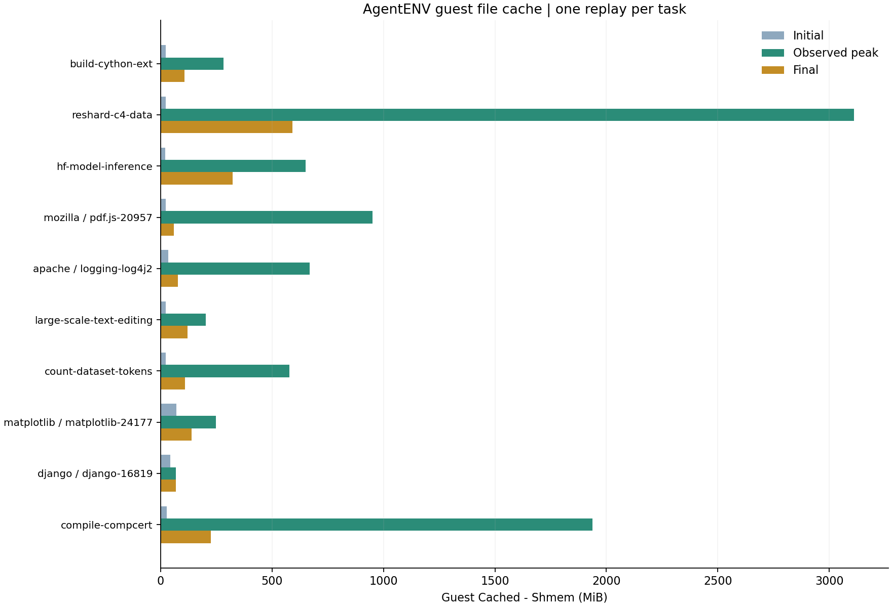

# Agent Sandbox Workload Results

最新实验于 **2026-10-23 至 24（Asia/Shanghai）** 在 cpu-15 的 AgentENV microVM 中完成：**10 个任务、652 次固定工具调用**，约每 200 ms 采集 guest 内存，每任务 3 个指定文件驻留边界。输入沿用原轨迹，不调用模型 API；失败尝试也单独归档。

这轮测量“**独立 guest 中有多少文件缓存**”。旧 Podman 初筛完整保留在 [2026-10-20 历史报告](PODMAN-20261020.md) 和 [旧结果索引](results/README.md)。宿主文件驻留、容器 cgroup 记账和 guest 文件缓存的范围不同，不能互相替代。

## 最新 AgentENV 结果

每项新建独立 VM，2 vCPU，除 CompCert 为 32 GiB 外均为 8 GiB RAM。下表缓存采用 guest `max(0,Cached-Shmem)`，Buffers 单列保存在 CSV；单位 MiB=2²⁰ bytes。峰值合并轨迹阶段周期样本、工具前后快照及 F0/Fend，排除扫描区间的周期样本。

| 任务 | 调用数 | 工具合计 (s) | guest 文件缓存 初始→观测峰值→结束 (MiB) | 实际验证范围 |
| --- | ---: | ---: | --- | --- |
| [build-cython-ext](results/agentenv/build-cython-ext/README.md) | 83 | 143.67 | 23.6 → 283.5 → 107.4 | 扩展导入、两轮各 18 测试通过 |
| [reshard-c4-data](results/agentenv/reshard-c4-data/README.md) | 36 | 38.76 | 23.2 → 3110.4 → 590.8 | 9,898 文件全量内容/结构往返通过 |
| [hf-model-inference](results/agentenv/hf-model-inference/README.md) | 11 | 83.34 | 21.3 → 651.3 → 324.5 | HTTP 服务正负样例通过 |
| [mozilla__pdf.js-20957](results/agentenv/mozilla__pdf.js-20957/README.md) | 5 | 171.90 | 23.0 → 950.5 → 60.6 | 两轮 CLI 测试通过 |
| [apache__logging-log4j2](results/agentenv/apache__logging-log4j2/README.md) | 10 | 313.54 | 34.5 → 670.1 → 77.5 | Maven 编译成功；跳过测试；检查器 141 |
| [large-scale-text-editing](results/agentenv/large-scale-text-editing/README.md) | 50 | 337.95 | 23.1 → 203.3 → 121.2 | 输出字节比对通过；不改原判题结论 |
| [count-dataset-tokens](results/agentenv/count-dataset-tokens/README.md) | 16 | 196.25 | 22.8 → 578.6 → 109.2 | 79,586 答案检查通过；实际计数 26 行 |
| [matplotlib__matplotlib-24177](results/agentenv/matplotlib__matplotlib-24177/README.md) | 95 | 55.93 | 70.7 → 248.0 → 138.7 | 最终两轮 60 passed；补丁与旧记录一致 |
| [django__django-16819](results/agentenv/django__django-16819/README.md) | 28 | 11.01 | 44.3 → 68.5 → 68.4 | 仅原范围语法检查通过 |
| [compile-compcert](results/agentenv/compile-compcert/README.md) | 318 | 1939.82 | 28.8 → 1937.0 → 226.0 | 最终编译器编译运行检查通过 |

全部主记录的工具退出码与原 Podman 重放记录一致；原预期非零调用仍保留。Log4j 的原检查器退出 **141**，没有改写成通过；其 Maven BUILD SUCCESS 与检查器状态分别报告。任务完成和局部验证不代表源 benchmark 的模型修复正确性。



[详细结果索引](results/agentenv/README.md) · [汇总 CSV](results/agentenv/summary.csv) · [汇总 JSON](results/agentenv/summary.json) · [矢量图](results/agentenv/overview.svg) · [失败与诊断尝试](results/agentenv/diagnostics/README.md)

每个任务页面含工具时延、guest 总内存/匿名内存/文件缓存三幅曲线，以及连续 CSV、工具 CSV、首尾快照、指定文件 mincore 边界、校准、验证、镜像和代码身份。固定可执行输入与实际 guest 控制脚本也公开。完整 stdout/stderr 和二进制归档保留在 cpu-15，不公开凭据或原对话。

## 结果边界

本轮采用新 guest，未控制 host backing 的冷暖，保持官方 guest 内核 6.1.175 与 DAMON 默认回收策略。初始值包含开机、辅助工具和校准后的状态；源轨迹中的业务安装/下载仍在原位置执行。结束值取自最终扫描和独立验证之前。

指定文件驻留只覆盖 `run.json` 声明路径的普通文件；它与整个 guest 的 Cached-Shmem 范围不同。CompCert 声明列表未覆盖 `/tmp/rocq-*` 等全部工具链源码目录，不能把其 mincore 点当作完整文件工作集。文件驻留扫描不提供实际读写字节量或 host PFN 去重。

每任务仅一次主记录，没有重复统计或置信区间。与旧 Podman 的差异同时受记账范围、guest 缓存状态、内核、DAMON 和测量协议影响，**不据此推导跨沙箱共享率、DAX 收益或内存节省比例，也不作为配对性能比较**。

## 核查与复算

[测量口径](docs/agentenv-measurement.md) · [部署与失败恢复](docs/agentenv-deployment.md) · [重放规程与采集代码](experiments/agentenv-memory/README.md) · [运行选择清单](provenance/agentenv-runs.json) · [校验回执](provenance/agentenv-validation.json) · [环境与清理回执](provenance/agentenv-environment.json)

仅用公开数据即可复算新摘要并重画；不重新执行业务任务：

```bash
python3 -m pip install -r experiments/agentenv-memory/requirements-analysis.txt
python3 scripts/rebuild_agentenv_public.py --root . --verify-only
python3 scripts/rebuild_agentenv_public.py --root .
python3 scripts/verify_archive.py
```

重画图片可能因字体/绘图库版本而改变图片哈希；数值哈希单独校验。若有意更新图片，再用 `python3 scripts/verify_archive.py --write-manifest` 刷新公开文件清单。旧 `build_results.py` 仍需 cpu-15 完整原始归档，重建的历史首页写入 `PODMAN-20261020.md`。
