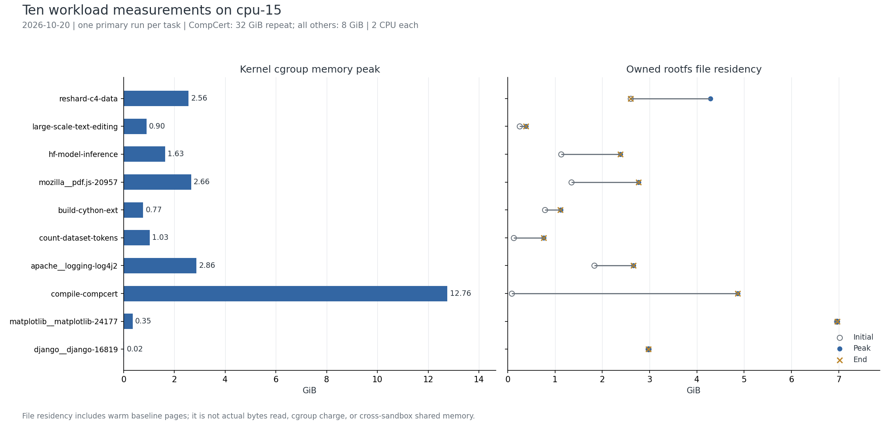

# Agent Sandbox Workload Results

在 cpu-15 上完成 **10 个任务的固定公开工具轨迹重放**，收集工具时延、容器内存变化和逐工具冻结后的文件缓存驻留。十任务主结果共 **652 次工具调用、662 个缓存边界**；CompCert 额外保留 8 GiB 原记录，仓库共 11 次完整运行、970 次调用、981 个边界。实验日期为 **2026-10-20，Asia/Shanghai**。

这是为后续 Agent Sandbox FS 多租户、Page Cache 和 DAX 实验进行的容器初筛。公开轨迹直接提供工具调用，不重新创建 LLM Agent，也不调用模型 API。十项采集完成与任务修复正确、官方判题通过是不同结论；Notion 的“已跑完”也仅表示本轮采集完成。原候选共 15 项，本仓库只覆盖已运行的 10 项。

## 十任务整体结果

各项顺序运行，2 CPU；除 CompCert 主记录为 **32 GiB** 外均为 **8 GiB** 上限。内存以 cgroup v2 计费为准；文件驻留由冻结容器后的两遍 mincore 扫描得到，只覆盖拥有且可扫描的根文件系统普通文件。文件驻留包含初始暖缓存，不能当作本轮实际读取量，也不能与 cgroup 内存相加。

| 任务与结果文档 | 调用数 | 工具合计 (s) | cgroup 峰值 (MiB) | 文件驻留 初始→最大→结束 (MiB) | 本地验证范围 |
| --- | --- | --- | --- | --- | --- |
| [reshard-c4-data](results/reshard-c4-data/README.md) | 36 | 23.42 | 2620.7 | 2660.7 → 4390.6 → 2660.8 | 全量往返比对通过 |
| [large-scale-text-editing](results/large-scale-text-editing/README.md) | 50 | 329.18 | 920.8 | 252.4 → 392.6 → 392.6 | 输出字节比对通过；源判题失败 |
| [hf-model-inference](results/hf-model-inference/README.md) | 11 | 74.68 | 1674.0 | 1152.0 → 2434.3 → 2434.3 | 服务正负样例通过 |
| [mozilla__pdf.js-20957](results/mozilla__pdf.js-20957/README.md) | 5 | 168.36 | 2721.1 | 1376.7 → 2835.4 → 2835.4 | 两轮 CLI 测试通过 |
| [build-cython-ext](results/build-cython-ext/README.md) | 83 | 127.51 | 787.1 | 801.4 → 1145.2 → 1140.1 | 扩展导入及两轮 18 测试通过 |
| [count-dataset-tokens](results/count-dataset-tokens/README.md) | 16 | 250.33 | 1050.1 | 123.4 → 779.8 → 779.8 | 79,586 结果检查通过 |
| [apache__logging-log4j2](results/apache__logging-log4j2/README.md) | 10 | 440.00 | 2930.5 | 1871.5 → 2716.3 → 2716.3 | 编译成功；跳过测试；检查器有 141 |
| [compile-compcert](results/compile-compcert/README.md) | 318 | 2068.81 | 13068.3 | 80.9 → 4976.7 → 4976.7 | 编译器编译运行通过 |
| [matplotlib__matplotlib-24177](results/matplotlib__matplotlib-24177/README.md) | 95 | 48.58 | 360.2 | 7129.5 → 7138.4 → 7138.4 | 60 局部测试通过；补丁一致 |
| [django__django-16819](results/django__django-16819/README.md) | 28 | 5.85 | 21.2 | 3049.0 → 3049.0 → 3049.0 | 仅语法检查通过 |


原始单位为 bytes、ns、s；MiB=2²⁰ bytes，GiB=2³⁰ bytes。`memory.peak` 是内核高水位，可能包含预检；连续曲线覆盖基线与轨迹测量。各项单次运行，没有误差条。详细结果、失败调用、文件区域表和曲线均可点击任务名称阅读。



[汇总 CSV](results/summary.csv) · [汇总 JSON](results/summary.json) · [矢量图](results/overview.svg) · [结果索引](results/README.md)

CompCert 8 GiB 原运行峰值触及 8 GiB，`memory.events.max=31`，`oom=0`、`oom_kill=0`。32 GiB 复测内存峰值约 **12.762 GiB**，文件驻留峰值/结束值约 **4.860 GiB**，限额与 OOM 事件均为 0。[两轮曲线及指标](results/compile-compcert/README.md#8-gib-与-32-gib-复测)保留原记录，时延变化不能单独归因于限额。

## 实际执行了哪些数据与操作

| 任务 | 实际执行范围 |
| --- | --- |
| C4 | 9,898 个文件、779.6 MiB 输入的全量压缩/解压、内容和目录往返比对 |
| 百万行 CSV | 读取一百万行输入、生成输出，与一百万行期望输出做字节比对；输入与期望合计约 85.0 MiB |
| HF 推理 | 下载约 1,278.6 MiB 的多格式模型快照，启动 CPU 服务并进行 HTTP 推理；不意味着推理读取了所有权重格式 |
| PDF.js | 905 个 npm 包安装、构建和两轮 CLI 测试；node_modules 约 230.7 MiB，另有浏览器下载缓存 |
| Cython | pyknotid 源码与头文件访问、原生扩展构建、三个 .so 导入和两轮各 18 个测试 |
| token 计数 | 46 个依赖版本安装，读取 1,000 行 metadata，筛选三个领域共 **26 行**文本计数，结果 79,586 |
| Log4j2 | 固定提交上的 Java 11/17 环境切换和 Maven 编译，`-DskipTests`，不含测试 |
| CompCert | Coq/OCaml/CompCert 源码与工具链构建、后台构建轮询、证明尝试和最终编译运行 |
| Matplotlib | 源码检索、局部补丁和直方图相关测试，最终 60 passed、10 skipped、762 deselected |
| Django | 公开轨迹中 28 次源码检索/修改调用，结束后仅补做语法检查 |

这些范围由固定命令、stdout/stderr、本地验证及边界目录统计支持。**本轮没有收集系统调用级 read/write 字节量、逐文件访问次数或缺页事件**；扫描返回的是“哪些文件页当时驻留”。不能据此给出活跃工作集的完整访问清单。

## 权限条件与测量方式

实验时 Agent Sandbox 平台暂不可用，`rashen` 账号未能访问 KVM，sudo 需要密码。经确认采用 **rootless Podman + 用户 cgroup v2**；没有修改 KVM/用户组权限，也没有运行 microVM。因此内存曲线是 **容器 cgroup 内存，不是 guest 物理内存**。

每次工具执行采用容器内单调时钟计时；约每 200 ms 采集 `memory.current`、`memory.peak`、`memory.stat` 等。工具结束后暂停容器、确认 `cgroup.events` 的 `frozen=1`，对 `/proc/<pid>/root` 执行两遍 `PROT_NONE mmap + mincore` 扫描，再恢复容器。初始边界加每个工具后的边界，共 N+1 个。扫描、冻结等待和异步依赖等待单列，不计入工具执行时延。图中的测量墙钟包含这些等待，不保留原模型思考间隔。[完整口径与边界](docs/measurement.md)。

rootless 扫描只计拥有的普通文件，以避免 mincore 对非拥有者文件返回保守驻留信息：PDF.js 排除 14 个文件约 5.1 MiB，Matplotlib 排除 757 个约 12.44 MiB，其驻留量未知。Matplotlib 镜像导入在专用存储启用 `ignore_chown_errors`，因此该项不能用于权限隔离评估。

`read/write` 工具通过真实文件操作桥接；持续 shell、异步调用、IP/PID 和固定依赖等适配均留有逐步记录。适配保持可执行的文件系统行为，不声称源 Agent 原生工具的实现与时延完全等价。

## 如何解读与继续使用

C4、模型下载/推理、PDF.js 依赖安装、Log4j2 和 CompCert 优先用于后续文件共享实验；Cython、CSV 可作为编译/文本处理对照。token 计数、Matplotlib 与 Django 更适合作为小业务输入或小增量对照。这个顺序依据本轮执行内容与驻留变化，尚未通过并发实验验证共享节省量。

Matplotlib 与 Django 的大部分驻留在轨迹开始前已存在。新写入的构建目录、压缩包、模型下载副本和安装输出也未必跨 sandbox 共享。后续需要在相同输入/只读快照、多实例并发和受控缓存条件下，另测实际访问与唯一物理页；本轮没有多租户 PFN 去重或 DAX 对照，不能推出内存节省比例。

所有实验容器已删除，第二批及 CompCert 复测本轮新增镜像已清理；第一批镜像仍留在 cpu-15 的专用存储供复用。结束时容器可写层只在第二批/复测采集，**不是磁盘峰值**。本次公开提交包含文档、图表、汇总、可读 CSV 和脚本；完整压缩原始序列、日志与轨迹单独保留在 cpu-15。

## 文档与目录

| 入口 | 内容 |
| --- | --- |
| [环境搭建与部署](docs/deployment/README.md) | 硬件、权限边界、依赖、镜像构建、代理与断线运行 |
| [测量口径](docs/measurement.md) | 时延、内存、Page Cache、扫描范围、图表时间轴 |
| [实验规程与重放](experiments/container-screening/README.md) | 固定轨迹、运行入口、适配和清理 |
| [十任务结果索引](results/README.md) | 每任务实验文档、数据表、PNG/SVG 与 CompCert 对照 |
| [来源与数据布局](docs/data-and-sources.md) | 轨迹 URL/revision/哈希、压缩序列、原始日志、服务器存档 |
| [数据校验](docs/validation.md) | 覆盖、N+1 边界、冻结、OOM、来源、图表及复现校验 |

```text
experiments/container-screening/  固定规程、原采集器、环境定义与来源记录
results/<task>/README.md          每任务说明、表格、曲线与解释
results/<task>/runs/<run-id>/     指标 CSV、配置、验证记录与 PNG/SVG 曲线
provenance/                      来源清单、原始校验、文件哈希与服务器索引
scripts/                         重算、部署准备、来源下载和归档校验
```

复算需要 cpu-15 的完整本地归档；在新 checkout 中先设置 ASWR_ARCHIVE_ROOT。只阅读本仓库的文档、图表和汇总不需要这些归档。

```bash
MPLCONFIGDIR=/tmp/aswr-matplotlib python3 scripts/build_results.py
python3 scripts/verify_archive.py
```

本仓库参考 [IncrementalDAX_moti](https://github.com/132ash/IncrementalDAX_moti) 的“实验规程 / 部署文档 / 按任务结果”组织方式，完整数值序列单独保留在 cpu-15，可提供本地归档用于重算。该仓库的 AgentENV/TrEnv-X、guest/PFN 指标与本轮容器测量不同；参考版本为 `a9bc7deadb68a6e24b7242eab343dfedf953ea38`，没有复制其 API 凭据或整套基线。
