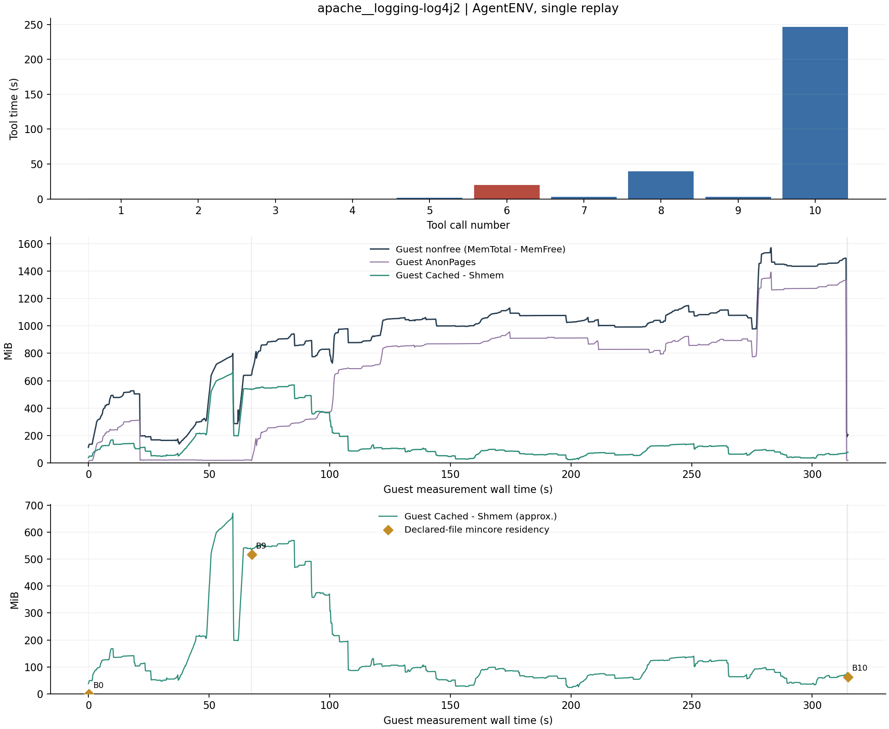

# apache__logging-log4j2：AgentENV

单实例固定轨迹完整重放，2 vCPU，8192 MiB guest RAM。

| 调用数 | 工具合计 (s) | guest 文件缓存 初始→观测峰值→结束 (MiB) | 严格退出码一致 | 独立验证 |
| --- | --- | --- | --- | --- |
| 10 | 313.539 | 34.49 → 670.08 → 77.49 | True | FAIL |

[完整数值与校验](runs/apache__logging-log4j2-20261023T160532Z-603454/summary.json) · [连续内存 CSV](runs/apache__logging-log4j2-20261023T160532Z-603454/memory.csv) · [逐工具 CSV](runs/apache__logging-log4j2-20261023T160532Z-603454/steps.csv) · [文件边界](runs/apache__logging-log4j2-20261023T160532Z-603454/boundaries.json)

Log4j 原检查器 `find | head` 配合 pipefail 返回 141；Maven BUILD SUCCESS 已单独核验，源轨迹跳过测试。

`Cached-Shmem` 为 guest 磁盘文件缓存近似量，Buffers 单列。菱形仅覆盖声明路径的普通文件驻留，两种范围不同。灰带为边界扫描；红色时延柱表示非零退出，并不自动表示平台失败。完整日志留在 cpu-15。
