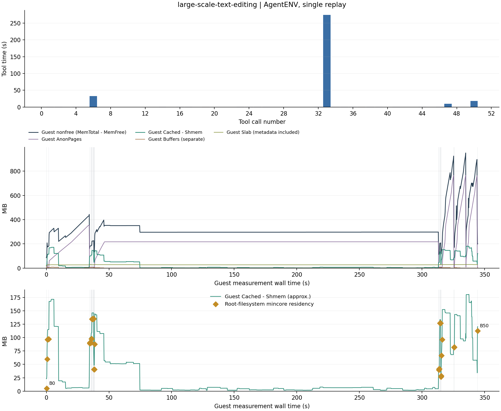
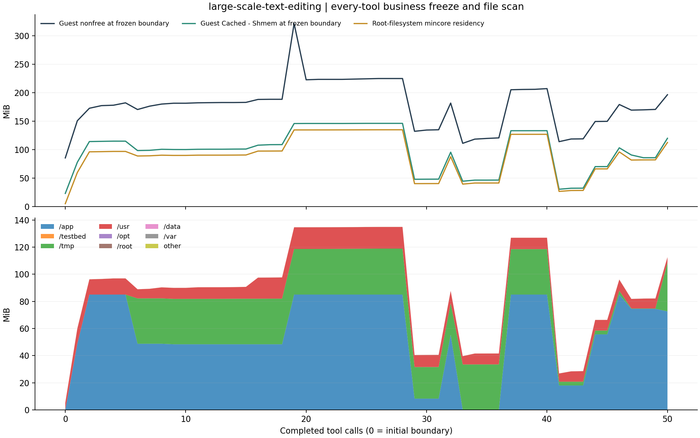

# large-scale-text-editing：AgentENV

单实例固定轨迹完整重放，2 vCPU，8192 MiB guest RAM。

| 调用数 | 工具合计 (s) | guest 文件缓存 初始→观测峰值→结束 (MiB) | 文件驻留 初始→边界峰值→结束 (MiB) | 严格退出码一致 | 独立验证 |
| --- | --- | --- | --- | --- | --- |
| 50 | 338.451 | 23.29 → 180.44 → 117.51 | 5.30 → 134.91 → 112.59 | True | PASS |

[完整数值与校验](runs/large-scale-text-editing-20261025T055608Z-975588/summary.json) · [连续内存 CSV](runs/large-scale-text-editing-20261025T055608Z-975588/memory.csv) · [逐工具 CSV](runs/large-scale-text-editing-20261025T055608Z-975588/steps.csv) · [文件边界](runs/large-scale-text-editing-20261025T055608Z-975588/boundaries.json)

初始边界加每工具返回后边界，共 **51 点**；业务组冻结均已验证，扫描错误为零。扫描合计 4.94 s，冻结控制合计 5.70 s（包含扫描）。两遍扫描间变化的 PARTIAL 边界 0 个。

初始扫描前后：非空闲 +14.74 MiB、Slab +13.66 MiB、Buffers +4.46 MiB。总内存曲线包含观察器与元数据扰动，不能当作无扫描时的纯业务需求；这些前后变化也不是因果扣除值。

[边界 CSV](runs/large-scale-text-editing-20261025T055608Z-975588/boundaries.csv) · [阶段摘要](runs/large-scale-text-editing-20261025T055608Z-975588/phase-summary.csv) · [冻结控制脚本](runs/large-scale-text-editing-20261025T055608Z-975588/guest-runner.sh) · [业务 worker](runs/large-scale-text-editing-20261025T055608Z-975588/guest-worker.sh)

`Cached-Shmem` 为 guest 磁盘文件缓存近似量，Buffers 单列。菱形覆盖根文件系统可达普通文件，虚拟挂载、其他挂载、符号链接和控制路径明确排除。业务 cgroup 冻结，观察器和内核继续运行；扫描并非原子物理快照。阶段标签描述工具时间窗口，包含先前留下的缓存，不能当作页来源。两种统计范围不同。灰带为扫描；红色时延柱表示非零退出，并不自动表示平台失败。完整日志留在 cpu-15。

[测量协议](../../../docs/agentenv-measurement.md) · [字段说明](../../../experiments/agentenv-memory/README.md)
