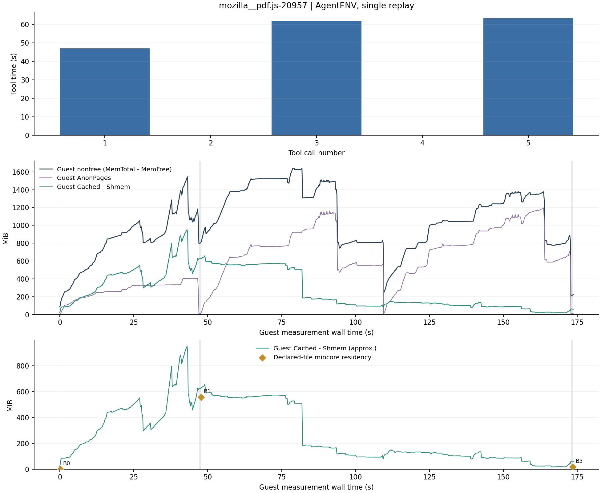

# mozilla__pdf.js-20957：AgentENV

单实例固定轨迹完整重放，2 vCPU，8192 MiB guest RAM。

| 调用数 | 工具合计 (s) | guest 文件缓存 初始→观测峰值→结束 (MiB) | 严格退出码一致 | 独立验证 |
| --- | --- | --- | --- | --- |
| 5 | 171.896 | 22.96 → 950.54 → 60.57 | True | PASS |

[完整数值与校验](runs/mozilla__pdf.js-20957-20261023T160041Z-601176/summary.json) · [连续内存 CSV](runs/mozilla__pdf.js-20957-20261023T160041Z-601176/memory.csv) · [逐工具 CSV](runs/mozilla__pdf.js-20957-20261023T160041Z-601176/steps.csv) · [文件边界](runs/mozilla__pdf.js-20957-20261023T160041Z-601176/boundaries.json)

`Cached-Shmem` 为 guest 磁盘文件缓存近似量，Buffers 单列。菱形仅覆盖声明路径的普通文件驻留，两种范围不同。灰带为边界扫描；红色时延柱表示非零退出，并不自动表示平台失败。完整日志留在 cpu-15。
