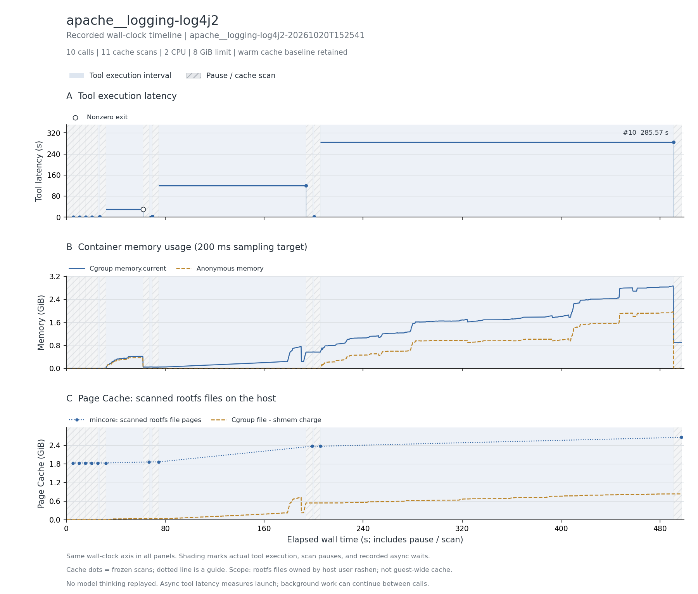

# Log4j2 Java/Maven 编译

EnvBench 轨迹中的 9 次 Agent 命令，加 1 次 SDKMAN 初始化，共 10 次。

最后编译调用退出 0、BUILD SUCCESS，且输出 class 文件。命令使用 -DskipTests，因此只证明编译，不代表测试通过。

主记录：`apache__logging-log4j2-20261020T152541`，实验日期 2026-10-20（Asia/Shanghai）。

## 实际执行与输入范围

固定项目提交 204d8251295dfa816b9b28d8d9cfaebab500f415，使用持续 Bash 保持 SDKMAN/JDK 状态。保留 Java 11 编译失败，切换 Java 17 后 Maven 构建；访问 JDK modules、Maven 依赖缓存、项目源码与 target/classes。最终 Maven 输出 474 goals。

## 结果表

下表的文件驻留以可扫描根文件系统的 inode/offset 为单位；cgroup 内存包含被计费缓存。它们口径不同，不能相加，也不是实际 read/write 字节量。峰值可能发生于不同时间。

| 指标 | 结果 |
| --- | --- |
| 完整工具调用 / 缓存边界 / 连续样本 | 10 / 11 / 2,475 |
| CPU 配额 / 内存上限 | 2 CPU / 8 GiB |
| 工具执行合计 / 中位数 / P95 / 最大 (s) | 439.998 / 1.374 / 210.645 / 285.566 |
| 容器调用合计 (s) | 440.156 |
| 测量墙钟 / 暂停总计 / 两遍扫描总计 (s) | 497.503 / 56.899 / 54.159 |
| 后台依赖等待 (s) | 0.000（0 个边界） |
| cgroup 内存内核峰值 / 采样峰值 (MiB) | 2930.453 / 2930.109 |
| 匿名内存峰值 / 文件页计费峰值 (MiB) | 2008.961 / 851.980 |
| 文件驻留：初始 / 最大 / 结束 (MiB) | 1871.535 / 2716.270 / 2716.270 |
| 文件驻留净变化 (MiB) | +844.734 |
| 扫描中位数 / 采样最大间隔 (s) | 4.813 / 0.259 |
| 非拥有者文件排除数 / 逻辑大小 (MiB) | 0 / 0.000 |
| memory.events max / oom / oom_kill | 0 / 0 / 0 |
| 结束时 Podman SizeRw / SizeRootFs (GiB) | 0.804 / 2.577（均非磁盘峰值） |
| 非零退出的工具编号 | 6 |
| 与源数值退出码不同的工具编号 | 无 |

## 三项曲线

[矢量图](runs/apache__logging-log4j2-20261020T152541/curves.svg)。三幅图共用测量墙钟：蓝色阴影标出工具执行区间，灰色斜线标出暂停扫描，金色点纹标出异步依赖等待（如有）。第一幅显示逐工具时延，空心点表示非零退出；第二幅为容器 cgroup 内存；第三幅明确显示 Page Cache，其中圆点为暂停后的 mincore 扫描值，点间虚线只辅助阅读。

[去除扫描暂停的辅助图](runs/apache__logging-log4j2-20261020T152541/curves-active.png) · [辅助图 SVG](runs/apache__logging-log4j2-20261020T152541/curves-active.svg)。辅助图只压缩暂停区间，仍保留调度与异步等待；暂停期间的内存样本用灰点显示。两种视图均保留初始暖缓存，不包含模型思考。指标定义见[测量说明](../../docs/measurement.md#时间轴与未测项)。

## 文件范围与驻留

以下按结束时驻留量取前八个区域；逻辑大小是文件大小之和，驻留量按页取整。目录分区说明见[测量口径](../../docs/measurement.md)。这些数据描述文件驻留，不能证明本轮调用读取了每个文件。

| 区域 | 结束时文件数 | 逻辑大小 (MiB) | 初始驻留 (MiB) | 结束驻留 (MiB) |
| --- | --- | --- | --- | --- |
| `/root` | 4853 | 1597.00 | 801.49 | 1610.86 |
| `/usr` | 14872 | 735.96 | 770.14 | 770.14 |
| `/opt` | 10904 | 214.51 | 244.40 | 244.40 |
| `/data` | 10384 | 46.69 | 37.67 | 73.03 |
| `/var` | 1481 | 8.93 | 13.55 | 13.55 |
| `/datas` | 42 | 2.98 | 3.10 | 3.10 |
| `/etc` | 211 | 0.56 | 1.18 | 1.18 |

总驻留峰值边界为工具 `10` 后。该边界的前五个驻留文件：

| 文件 | 驻留 (MiB) |
| --- | --- |
| `/root/.sdkman/tmp/java-17.0.14-zulu.zip` | 193.05 |
| `/root/.sdkman/tmp/java-11.0.20-tem.zip` | 190.30 |
| `/root/.sdkman/candidates/java/11.0.20-tem/lib/modules` | 136.05 |
| `/root/.sdkman/tmp/gradle-8.14.2.zip` | 131.03 |
| `/root/.sdkman/candidates/java/17.0.14-zulu/lib/modules` | 125.00 |

## 时延较长的工具

| 工具编号 | 类型 | 命令摘要 | 时延 (s) | 退出码 |
| --- | --- | --- | --- | --- |
| 10 | bash | mvn compile -DskipTests -B | 285.566 | 0 |
| 8 | bash | sdk install java 17.0.14-zulu | 119.075 | 0 |
| 6 | bash | mvn compile -DskipTests -B | 29.934 | 1 |
| 7 | bash | sdk list java | 2.623 | 0 |
| 5 | bash | sdk current java | 1.475 | 0 |
| 9 | bash | sdk use java 17.0.14-zulu | 1.273 | 0 |
| 1 | bash | [ -f '/root/.sdkman/bin/sdkman-init.sh' ] && source /root/.sdkman/bin/sdkman-init.sh \|\| true | 0.041 | 0 |
| 2 | bash | ls | 0.004 | 0 |

## 适配、权限与解释限制

附加检查的 find | head 在 pipefail 下返回 141（SIGPIPE）；原 FAIL 原样保留，另有 validation-evidence.json 记录编译成功证据，不覆盖原检查。

两遍扫描无错误，changed_pages=0；全部边界确认 frozen=1。指标口径见[测量说明](../../docs/measurement.md)。

优先保留 JVM 与 Maven 缓存场景；预安装 JDK/依赖可复用，每实例 target 构建产物应视为私有。

本记录的适配类别如下；逐步命令、改动说明和脚本哈希保存在 normalized-steps.json.gz。

- Bash uses default pipeline exit semantics, matching published commands; no implicit pipefail.
- Execute in one persistent Bash shell; clock_gettime helper brackets each sourced command. Original PTY rendering and terminal wait duration are not replayed.

## 数据、来源与复现

- [逐工具时延 CSV](runs/apache__logging-log4j2-20261020T152541/steps.csv)、[边界指标 CSV](runs/apache__logging-log4j2-20261020T152541/boundaries.csv)、[汇总](runs/apache__logging-log4j2-20261020T152541/metrics.json)、[运行配置](runs/apache__logging-log4j2-20261020T152541/run.json)。
- [来源 URL / revision / SHA-256](../../experiments/container-screening/workloads/apache__logging-log4j2/provenance.json)。
- 完整连续序列、逐步命令和 stdout/stderr 保存在 cpu-15 的原始归档。
- [数据说明](../../docs/data-and-sources.md)、[部署说明](../../docs/deployment/README.md)。

[返回十任务总览](../../README.md)
