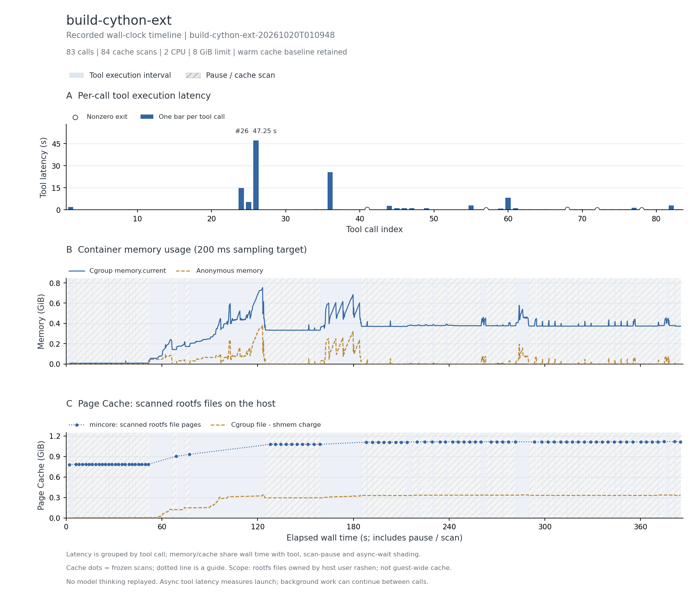

# Cython 原生扩展编译

Terminal-Bench 社区公开轨迹，完整 83 次调用。

三个编译扩展导入成功；两轮各 18 tests passed，未发现失败汇总。

主记录：`build-cython-ext-20261020T010948`，实验日期 2026-10-20（Asia/Shanghai）。

## 实际执行与输入范围

克隆 pyknotid 0.5.3，读取源码、Cython 与 NumPy 头文件，尝试编译和修复扩展，再安装并运行测试。真实加载 cinvariants、chelpers、ccomplexity 三个 .so；源码与安装目录各跑一轮测试。

## 结果表

下表的文件驻留以可扫描根文件系统的 inode/offset 为单位；cgroup 内存包含被计费缓存。它们口径不同，不能相加，也不是实际 read/write 字节量。峰值可能发生于不同时间。

| 指标 | 结果 |
| --- | --- |
| 完整工具调用 / 缓存边界 / 连续样本 | 83 / 84 / 1,911 |
| CPU 配额 / 内存上限 | 2 CPU / 8 GiB |
| 工具执行合计 / 中位数 / P95 / 最大 (s) | 127.508 / 0.035 / 5.156 / 47.254 |
| 容器调用合计 (s) | 138.494 |
| 测量墙钟 / 暂停总计 / 两遍扫描总计 (s) | 385.039 / 246.232 / 229.717 |
| 后台依赖等待 (s) | 0.000（0 个边界） |
| cgroup 内存内核峰值 / 采样峰值 (MiB) | 787.113 / 771.863 |
| 匿名内存峰值 / 文件页计费峰值 (MiB) | 392.035 / 349.500 |
| 文件驻留：初始 / 最大 / 结束 (MiB) | 801.398 / 1145.180 / 1140.078 |
| 文件驻留净变化 (MiB) | +338.680 |
| 扫描中位数 / 采样最大间隔 (s) | 3.142 / 0.260 |
| 非拥有者文件排除数 / 逻辑大小 (MiB) | 0 / 0.000 |
| memory.events max / oom / oom_kill | 0 / 0 / 0 |
| 结束时 Podman SizeRw / SizeRootFs (GiB) | 未采集；不估算磁盘峰值 |
| 非零退出的工具编号 | 41、57、68、72、78 |
| 与源数值退出码不同的工具编号 | 无 |

## 三项曲线

[矢量图](runs/build-cython-ext-20261020T010948/curves.svg)。第一幅按工具编号显示时延，空心标记为非零退出；后两幅横轴含人为暂停扫描和后台等待，不含模型思考。初始暖驻留按实测保留。内核 memory.peak 可能高于 200 ms 序列捕获的峰值，也可能包含预检。

## 文件范围与驻留

以下按结束时驻留量取前八个区域；逻辑大小是文件大小之和，驻留量按页取整。目录分区说明见[测量口径](../../docs/measurement.md)。这些数据描述文件驻留，不能证明本轮调用读取了每个文件。

| 区域 | 结束时文件数 | 逻辑大小 (MiB) | 初始驻留 (MiB) | 结束驻留 (MiB) |
| --- | --- | --- | --- | --- |
| `/usr` | 21342 | 983.45 | 772.82 | 1030.71 |
| `/root` | 208 | 65.49 | 16.34 | 65.95 |
| `/app` | 269 | 30.56 | 0.00 | 31.19 |
| `/var` | 1219 | 7.56 | 11.41 | 11.41 |
| `/etc` | 136 | 0.46 | 0.83 | 0.83 |

总驻留峰值边界为工具 `82` 后。该边界的前五个驻留文件：

| 文件 | 驻留 (MiB) |
| --- | --- |
| `/usr/lib/x86_64-linux-gnu/libLLVM-15.so.1` | 111.88 |
| `/usr/lib/gcc/x86_64-linux-gnu/12/cc1plus` | 33.82 |
| `/usr/lib/gcc/x86_64-linux-gnu/12/cc1` | 31.80 |
| `/usr/lib/gcc/x86_64-linux-gnu/12/lto1` | 30.47 |
| `/usr/bin/x86_64-linux-gnu-lto-dump-12` | 30.47 |

## 时延较长的工具

| 工具编号 | 类型 | 命令摘要 | 时延 (s) | 退出码 |
| --- | --- | --- | --- | --- |
| 26 | bash | pip install --quiet networkx peewee appdirs requests tqdm matplotlib 2>&1 \| tail -3; pip install --quiet plana | 47.254 | 0 |
| 36 | bash | pip install --quiet setuptools wheel 2>&1 \| tail -2; python -c "import setuptools; print('setuptools', setupto | 25.589 | 0 |
| 24 | bash | which gcc g++ cc; gcc --version \| head -1; pip install --quiet cython sympy pytest 2>&1 \| tail -5; python -c " | 14.749 | 0 |
| 60 | bash | pip install 'planarity==0.6' 2>&1 \| tail -4 && python -c " ↵ import planarity, inspect ↵ print('file:', planar | 8.212 | 0 |
| 25 | bash | pip install --quiet vispy 2>&1 \| tail -3; python -c "import vispy; print('vispy', vispy.__version__)" | 5.401 | 0 |
| 82 | bash | echo "=== tests from /app/pyknotid (source-tree context) ===" && cd /app/pyknotid && python -m pytest tests/ - | 2.952 | 0 |
| 55 | bash | cd /app/pyknotid && pip install --no-build-isolation --no-warn-script-location . 2>&1 \| tail -3 && cd /tmp &&  | 2.946 | 0 |
| 44 | bash | cd /tmp && git clone --quiet --filter=blob:none https://github.com/SPOCKnots/pyknotid.git pyknotid-full 2>/dev | 2.819 | 0 |

## 适配、权限与解释限制

保留源命令的编译失败与修复尝试。运行时依赖没有全部固定为离线快照；native read/write 通过真实文件操作桥接。

两遍扫描无错误，changed_pages=0；全部边界确认 frozen=1。指标口径见[测量说明](../../docs/measurement.md)。

保留为原生编译对照。编译器和头文件可复用，编译输出多为私有页；本轮文件驻留增量较小。

本记录的适配类别如下；逐步命令、改动说明和脚本哈希保存在 normalized-steps.json.gz。

- Bash uses default pipeline exit semantics, matching published commands; no implicit pipefail.
- Read adapter resolves the source tool's real path, reads full file bytes, and emits the published line span when available. Original semantic read implementation/timing is unavailable; output formatting is approximate.
- Native write tool is bridged to a real in-container file write; original content is preserved except explicitly declared adaptations.

## 数据、来源与复现

- [逐工具时延 CSV](runs/build-cython-ext-20261020T010948/steps.csv)、[边界指标 CSV](runs/build-cython-ext-20261020T010948/boundaries.csv)、[汇总](runs/build-cython-ext-20261020T010948/metrics.json)、[运行配置](runs/build-cython-ext-20261020T010948/run.json)。
- [来源 URL / revision / SHA-256](../../experiments/container-screening/workloads/build-cython-ext/provenance.json)。
- 完整连续序列、逐步命令和 stdout/stderr 保存在 cpu-15 的原始归档。
- [数据说明](../../docs/data-and-sources.md)、[部署说明](../../docs/deployment/README.md)。

[返回十任务总览](../../README.md)
