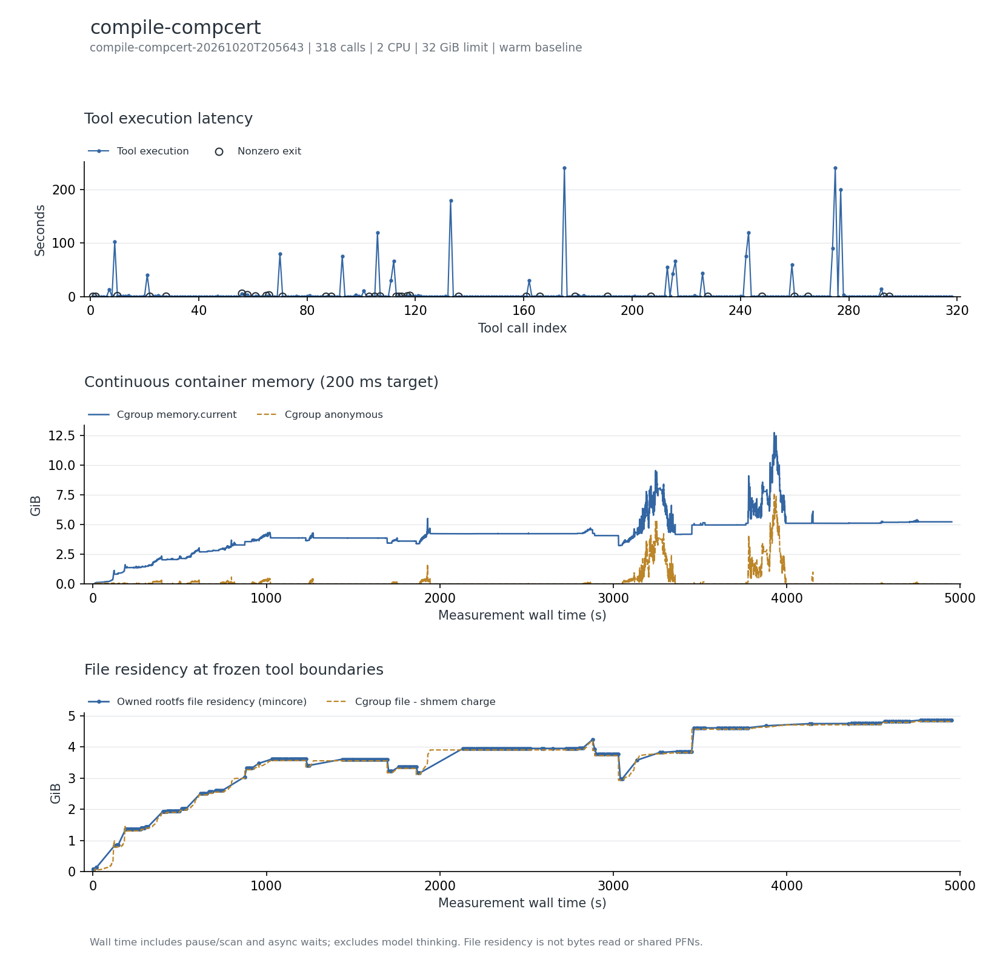
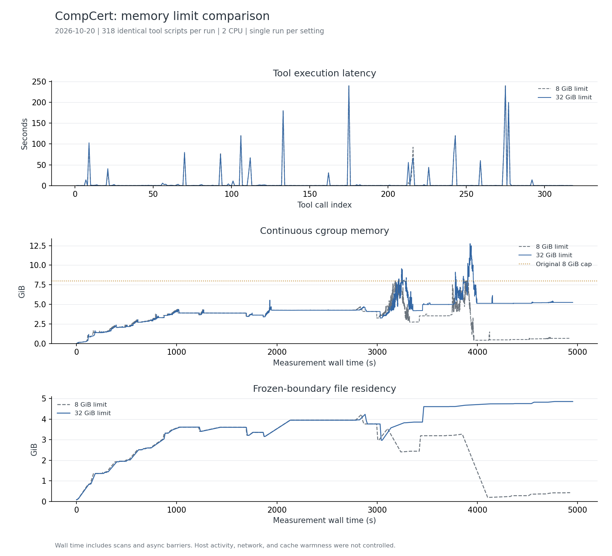

# CompCert 与 Coq 工具链构建

Lottolabs 真正可下载的 318 调用轨迹；不采用旧候选表中的约 34 回合 T1 记录。8 GiB 初筛与 32 GiB 复测都完整采集。

**本轮已完成全部公开调用和三类数据采集。** 两轮均 318 次调用、319 个缓存边界；最终 CompCert 3.13.1 编译运行 smoke check 通过。32 GiB 复测 memory.events 全为 0。

主记录：`compile-compcert-20261020T205643`，实验日期 2026-10-20（Asia/Shanghai）。本地检查、轨迹重放完成与官方 benchmark 判题是不同结论。

## 实际执行与输入范围

实际下载与解压 Coq/OCaml/CompCert 源码，配置和构建工具链，执行证明/编译尝试、后台构建与轮询；最后用生成的 CompCert 3.13.1 编译并运行小型 C 程序。/tmp 中源码和中间产物、/usr 安装工具链都进入根文件系统驻留扫描。

## 结果表

下表的文件驻留以可扫描根文件系统的 inode/offset 为单位；cgroup 内存包含被计费缓存。它们口径不同，不能相加，也不是实际 read/write 字节量。峰值可能发生于不同时间。

| 指标 | 结果 |
| --- | --- |
| 完整工具调用 / 缓存边界 / 连续样本 | 318 / 319 / 24,519 |
| CPU 配额 / 内存上限 | 2 CPU / 32 GiB |
| 工具执行合计 / 中位数 / P95 / 最大 (s) | 2068.811 / 0.020 / 42.708 / 240.012 |
| 容器调用合计 (s) | 2101.203 |
| 测量墙钟 / 暂停总计 / 两遍扫描总计 (s) | 4951.419 / 2713.579 / 2627.156 |
| 后台依赖等待 (s) | 136.090（9 个边界） |
| cgroup 内存内核峰值 / 采样峰值 (MiB) | 13068.340 / 13046.980 |
| 匿名内存峰值 / 文件页计费峰值 (MiB) | 7828.125 / 4944.312 |
| 文件驻留：初始 / 最大 / 结束 (MiB) | 80.918 / 4976.652 / 4976.652 |
| 文件驻留净变化 (MiB) | +4895.734 |
| 扫描中位数 / 采样最大间隔 (s) | 9.897 / 0.325 |
| 非拥有者文件排除数 / 逻辑大小 (MiB) | 0 / 0.000 |
| memory.events max / oom / oom_kill | 0 / 0 / 0 |
| 结束时 Podman SizeRw / SizeRootFs (GiB) | 4.573 / 4.649（均非磁盘峰值） |
| 非零退出的工具编号 | 1、2、10、22、28、56、58、61、65、66、71、87、89、103、105、107、113、114、115、117、118、136、161、166、179、191、207、228、248、260、265、293、295 |
| 与源数值退出码不同的工具编号 | 105、185、254 |

## 三项曲线

[矢量图](runs/compile-compcert-20261020T205643/curves.svg)。第一幅按工具编号显示时延，空心标记为非零退出；后两幅横轴含人为暂停扫描和后台等待，不含模型思考。初始暖驻留按实测保留。内核 memory.peak 可能高于 200 ms 序列捕获的峰值，也可能包含预检。

## 文件范围与驻留

以下按结束时驻留量取前八个区域；逻辑大小是文件大小之和，驻留量按页取整。目录分区说明见[测量口径](../../docs/measurement.md)。这些数据描述文件驻留，不能证明本轮调用读取了每个文件。

| 区域 | 结束时文件数 | 逻辑大小 (MiB) | 初始驻留 (MiB) | 结束驻留 (MiB) |
| --- | --- | --- | --- | --- |
| `/tmp` | 80638 | 2732.39 | 0.00 | 2937.80 |
| `/usr` | 13500 | 1591.85 | 75.81 | 1621.14 |
| `/opt` | 2030 | 350.17 | 0.00 | 354.38 |
| `/var` | 987 | 59.35 | 4.64 | 62.46 |
| `/etc` | 148 | 0.42 | 0.46 | 0.86 |
| `/root` | 3 | 0.00 | 0.01 | 0.01 |

总驻留峰值边界为工具 `315` 后。该边界的前五个驻留文件：

| 文件 | 驻留 (MiB) |
| --- | --- |
| `/usr/local/bin/coqtop.byte` | 56.35 |
| `/tmp/rocq-8.16.1/_build/default/topbin/coqtop_byte_bin.bc` | 56.35 |
| `/usr/local/bin/coqidetop.byte` | 39.47 |
| `/tmp/rocq-8.16.1/_build/default/ide/coqide/idetop.bc` | 39.47 |
| `/usr/local/bin/coqc.byte` | 38.91 |

## 时延较长的工具

| 工具编号 | 类型 | 命令摘要 | 时延 (s) | 退出码 |
| --- | --- | --- | --- | --- |
| 275 | bash | sleep 240; grep -c "COQC" /tmp/compcert-proof2.log; cat /tmp/compcert-proof2.rc 2>/dev/null \|\| echo "still run | 240.012 | 0 |
| 175 | bash | sleep 240; cat /tmp/coq-build.rc 2>/dev/null; tail -3 /tmp/coq-build.log | 240.007 | 0 |
| 277 | bash | sleep 200; cat /tmp/compcert-extr.rc 2>/dev/null \|\| echo "still running"; tail -8 /tmp/compcert-extr.log 2>/de | 200.009 | 0 |
| 133 | bash | sleep 180; wc -l /tmp/coq-build.log; tail -2 /tmp/coq-build.log | 180.007 | 0 |
| 243 | bash | sleep 120; ps aux \| grep -E "dune\|coqc\|ocaml" \| grep -v grep \| head -8; echo "---LOG---"; wc -l /tmp/coq-build | 120.023 | 0 |
| 106 | bash | sleep 120; tail -3 /tmp/ocaml-build.log | 120.005 | 0 |
| 9 | bash | wget() { ↵   local ASBP_FETCH_RC ASBP_FETCH_N ↵   for ASBP_FETCH_N in 1 2 3 4; do ↵     if command wget --time | 102.879 | 0 |
| 274 | bash | sleep 90; grep -c "COQC" /tmp/compcert-proof2.log 2>/dev/null; tail -3 /tmp/compcert-proof2.log 2>/dev/null; g | 90.017 | 0 |

## 适配、权限与解释限制

318 次调用包含较多显式 sleep/轮询；工具合计包含这些原命令等待，较长工具不一定是前台编译。async 时延只测启动，9 处依赖完成等待单列；wget 对网络/TLS 退出 4/5 最多四次重试，每次 30 秒。第 59 步前检查 Coq 包大小 7,402,490 字节。两轮相对源记录均在 105、185、254 步退出状态不同：进程轮询时刻、ls 原错误未复现、真实 coqc 成功。

两遍扫描均无错误且 changed_pages=0；每个边界均记录 frozen_verified=true。非零工具退出可对应源轨迹故意保留的失败尝试，不自动说明采集失败。匿名内存、文件驻留与 cgroup 文件计费没有共同的独占物理页分母；尚未测跨租户 PFN 共享或 DAX 效果。

优先保留为长轨迹编译压力场景。主结果采用 32 GiB 复测，原 8 GiB 曲线用于限额对照。需将可复用工具链/源码与私有构建输出分开，不能把全部文件页视为共享潜力。

本记录的适配类别如下；逐步命令、改动说明和脚本哈希保存在 normalized-steps.json.gz。

- Bash uses default pipeline exit semantics, matching published commands; no implicit pipefail.
- Bound wget network/TLS failures (exit4/5) to four attempts with30s timeout; preserve original URLs, flags, HTTP errors and successful outputs. Retries remain inside measured tool runtime. Added after a transient TLS EOF produced an empty Coq archive.
- Read adapter resolves the source tool's real path, reads full file bytes, and emits the published line span when available. Original semantic read implementation/timing is unavailable; output formatting is approximate.
- Use a static C read bridge for the minimal CompCert image, without adding Python dependencies. Read the whole file and emit requested line spans; native semantic formatting/timing remains unavailable.
- Preserve async=true as background dispatch; later recorded polls remain real commands. Timing measures launch, not whole background-job lifetime.
- Native write tool is bridged to a real in-container file write; original content is preserved except explicitly declared adaptations.

## 8 GiB 与 32 GiB 复测

8 GiB 原结果触及上限（max=31）但没有 OOM；主记录 32 GiB 未触及配置上限。两轮全部 318 个工具脚本哈希相同，harness 只调整内存限额。各配置仅一次；同机负载、联网和缓存未隔离，时延差不能全部归因于限额。

| 指标 | 8 GiB 原记录 | 32 GiB 主记录 |
| --- | --- | --- |
| run ID | compile-compcert-20261020T182356 | compile-compcert-20261020T205643 |
| cgroup 内存峰值 (GiB) | 8.000 | 12.762 |
| 文件驻留最大 / 结束 (GiB) | 4.235 / 0.423 | 4.860 / 4.860 |
| memory.events max / oom_kill | 31 / 0 | 0 / 0 |
| 工具执行合计 (min) | 33.51 | 34.48 |

[原 8 GiB 三项曲线](runs/compile-compcert-20261020T182356/curves.png) · [两轮数据表](comparison.csv)。32 GiB 主记录峰值约 12.76 GiB，说明这一轮超过了原 8 GiB 配置；不代表所有并发或环境下的统一上界。

## 数据、来源与复现

- [逐工具时延 CSV](runs/compile-compcert-20261020T205643/steps.csv)、[边界指标 CSV](runs/compile-compcert-20261020T205643/boundaries.csv)、[汇总](runs/compile-compcert-20261020T205643/metrics.json)、[运行配置](runs/compile-compcert-20261020T205643/run.json)。
- [来源 URL / revision / SHA-256](../../experiments/container-screening/workloads/compile-compcert/provenance.json)。
- 完整连续序列、逐步命令和 stdout/stderr 保留于 cpu-15 的原始归档，本次不公开上传压缩包；它们不影响直接阅读本页图表和结果。
- [数据说明](../../docs/data-and-sources.md)、[部署说明](../../docs/deployment/README.md)。

[返回十任务总览](../../README.md)
