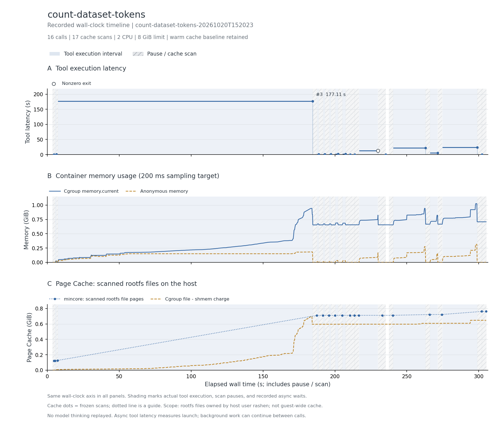

# 数据集加载与 token 计数

Terminal-Bench 社区公开轨迹，完整 16 次调用。

answer.txt 精确为 79586，计数脚本 py_compile 通过。

主记录：`count-dataset-tokens-20261020T152023`，实验日期 2026-10-20（Asia/Shanghai）。

## 实际执行与输入范围

按源轨迹安装 46 个固定版本依赖、读取固定 revision 的数据集 README，读取 OpenThoughts-1k-sample 的 1,000 行 metadata，再筛选 physics/chemistry/biology 共 26 行文本计数，结果 79,586。前一次访问不存在的 science 子集失败被保留。本项实际业务数据很小，资源曲线主要体现依赖安装、下载缓存和运行库加载。

## 结果表

下表的文件驻留以可扫描根文件系统的 inode/offset 为单位；cgroup 内存包含被计费缓存。它们口径不同，不能相加，也不是实际 read/write 字节量。峰值可能发生于不同时间。

| 指标 | 结果 |
| --- | --- |
| 完整工具调用 / 缓存边界 / 连续样本 | 16 / 17 / 1,501 |
| CPU 配额 / 内存上限 | 2 CPU / 8 GiB |
| 工具执行合计 / 中位数 / P95 / 最大 (s) | 250.330 / 1.104 / 62.476 / 177.115 |
| 容器调用合计 (s) | 254.724 |
| 测量墙钟 / 暂停总计 / 两遍扫描总计 (s) | 305.270 / 46.798 / 41.262 |
| 后台依赖等待 (s) | 0.000（0 个边界） |
| cgroup 内存内核峰值 / 采样峰值 (MiB) | 1050.051 / 1050.051 |
| 匿名内存峰值 / 文件页计费峰值 (MiB) | 322.234 / 713.535 |
| 文件驻留：初始 / 最大 / 结束 (MiB) | 123.402 / 779.762 / 779.762 |
| 文件驻留净变化 (MiB) | +656.359 |
| 扫描中位数 / 采样最大间隔 (s) | 2.787 / 0.248 |
| 非拥有者文件排除数 / 逻辑大小 (MiB) | 0 / 0.000 |
| memory.events max / oom / oom_kill | 0 / 0 / 0 |
| 结束时 Podman SizeRw / SizeRootFs (GiB) | 0.610 / 0.727（均非磁盘峰值） |
| 非零退出的工具编号 | 11 |
| 与源数值退出码不同的工具编号 | 无 |

## 三项曲线

[矢量图](runs/count-dataset-tokens-20261020T152023/curves.svg)。三幅图共用测量墙钟：蓝色阴影标出工具执行区间，灰色斜线标出暂停扫描，金色点纹标出异步依赖等待（如有）。第一幅显示逐工具时延，空心点表示非零退出；第二幅为容器 cgroup 内存；第三幅明确显示 Page Cache，其中圆点为暂停后的 mincore 扫描值，点间虚线只辅助阅读。

[去除扫描暂停的辅助图](runs/count-dataset-tokens-20261020T152023/curves-active.png) · [辅助图 SVG](runs/count-dataset-tokens-20261020T152023/curves-active.svg)。辅助图只压缩暂停区间，仍保留调度与异步等待；暂停期间的内存样本用灰点显示。两种视图均保留初始暖缓存，不包含模型思考。指标定义见[测量说明](../../docs/measurement.md#时间轴与未测项)。

## 文件范围与驻留

以下按结束时驻留量取前八个区域；逻辑大小是文件大小之和，驻留量按页取整。目录分区说明见[测量口径](../../docs/measurement.md)。这些数据描述文件驻留，不能证明本轮调用读取了每个文件。

| 区域 | 结束时文件数 | 逻辑大小 (MiB) | 初始驻留 (MiB) | 结束驻留 (MiB) |
| --- | --- | --- | --- | --- |
| `/usr` | 18552 | 571.31 | 116.32 | 612.01 |
| `/root` | 312 | 160.01 | 0.01 | 160.67 |
| `/var` | 519 | 4.80 | 6.37 | 6.37 |
| `/etc` | 108 | 0.41 | 0.70 | 0.70 |
| `/app` | 2 | 0.00 | 0.00 | 0.01 |

总驻留峰值边界为工具 `15` 后。该边界的前五个驻留文件：

| 文件 | 驻留 (MiB) |
| --- | --- |
| `/usr/local/lib/python3.13/site-packages/pyarrow/libarrow.so.2500` | 52.80 |
| `/root/.cache/pip/http-v2/5/2/e/2/d/52e2d6a55a4e20911b3e928b679f8884193b667da60ba18d80df6ebe.body` | 47.79 |
| `/usr/local/lib/python3.13/site-packages/pyarrow/libarrow_flight.so.2500` | 28.64 |
| `/root/.cache/huggingface/datasets/ryanmarten___open_thoughts-1k-sample/metadata/0.0.0/a82400884621626d41bef89b7604f8054e7e00e0/open_thoughts-1k-sample-train.arrow` | 26.74 |
| `/usr/local/lib/python3.13/site-packages/numpy.libs/libscipy_openblas64_-61654e39.so` | 24.04 |

## 时延较长的工具

| 工具编号 | 类型 | 命令摘要 | 时延 (s) | 退出码 |
| --- | --- | --- | --- | --- |
| 3 | bash | pip install -c /probe/input/source-constraints.txt datasets transformers tokenizers 2>&1 \| tail -5 | 177.115 | 0 |
| 15 | bash | cd /app && python3 -c " ↵ from datasets import load_dataset ↵ from transformers import AutoTokenizer ↵  ↵ ds = | 24.263 | 0 |
| 13 | bash | cd /app && python3 count_tokens.py | 22.397 | 0 |
| 11 | bash | cd /app && python3 count_tokens.py | 13.203 | 1 |
| 14 | bash | cd /app && python3 -c " ↵ from transformers import AutoTokenizer ↵ tok = AutoTokenizer.from_pretrained('Qwen/Q | 5.371 | 0 |
| 8 | bash | python3 -c " ↵ from huggingface_hub import hf_hub_download ↵ p = hf_hub_download('ryanmarten/OpenThoughts-1k-s | 2.103 | 0 |
| 7 | bash | python3 -c " ↵ from huggingface_hub import HfApi ↵ api = HfApi() ↵ info = api.dataset_info('ryanmarten/OpenTho | 1.891 | 0 |
| 5 | bash | python3 -c " ↵ import requests ↵ r = requests.get('https://huggingface.co/ryanmarten/OpenThoughts-1k-sample/ra | 1.117 | 0 |

## 适配、权限与解释限制

按公开安装输出约束依赖；不转发 ALL_PROXY，使用现有 HTTP/HTTPS 代理，以避开未安装 socksio 的客户端问题。诊断失败运行未合入结果。

两遍扫描无错误，changed_pages=0；全部边界确认 frozen=1。指标口径见[测量说明](../../docs/measurement.md)。

作为数据加载/依赖安装对照，暂不作为大数据扫描首选；不能因数据集名称把 26 行执行称为全量大数据处理。

本记录的适配类别如下；逐步命令、改动说明和脚本哈希保存在 normalized-steps.json.gz。

- Bash uses default pipeline exit semantics, matching published commands; no implicit pipefail.
- Do not forward ALL_PROXY: HF's HTTP client eagerly constructs an unused SOCKS transport without socksio. Use the same host HTTP/HTTPS proxy. Pin README download to the snapshot path recorded by the read tool.
- Constrain dependency versions to the exact Successfully installed list in public tool3; newer datasets dropped the requests dependency used by subsequent source calls.
- Read adapter resolves the source tool's real path, reads full file bytes, and emits the published line span when available. Original semantic read implementation/timing is unavailable; output formatting is approximate.
- Preserve the source write tool's madeExecutable metadata with chmod +x.
- Native write tool is bridged to a real in-container file write; original content is preserved except explicitly declared adaptations.

## 数据、来源与复现

- [逐工具时延 CSV](runs/count-dataset-tokens-20261020T152023/steps.csv)、[边界指标 CSV](runs/count-dataset-tokens-20261020T152023/boundaries.csv)、[汇总](runs/count-dataset-tokens-20261020T152023/metrics.json)、[运行配置](runs/count-dataset-tokens-20261020T152023/run.json)。
- [来源 URL / revision / SHA-256](../../experiments/container-screening/workloads/count-dataset-tokens/provenance.json)。
- 完整连续序列、逐步命令和 stdout/stderr 保存在 cpu-15 的原始归档。
- [数据说明](../../docs/data-and-sources.md)、[部署说明](../../docs/deployment/README.md)。

[返回十任务总览](../../README.md)
