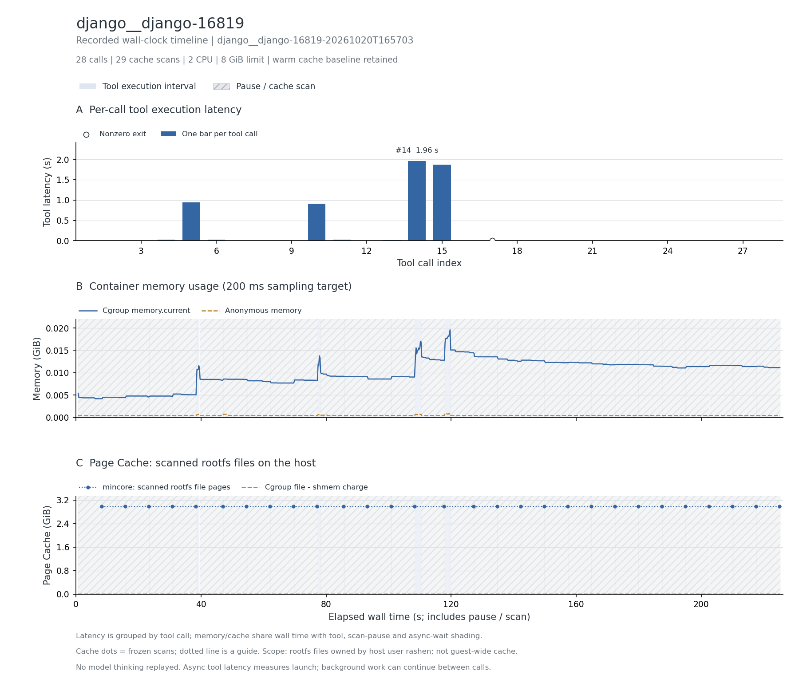

# Django 源码浏览与修改

公开轨迹中 28 次终端调用全部重放；原 Agent 因 3000 秒模型超时结束，非正常完成的端到端 Agent 轨迹。

结束后仅对改动文件做 py_compile 语法检查，结果通过；不足以证明修复正确。源记录 reward=1.0 不能代替本轮官方判题。

主记录：`django__django-16819-20261020T165703`，实验日期 2026-10-20（Asia/Shanghai）。

## 实际执行与输入范围

持续 Bash 中读取、检索并修改 django/db/migrations/operations/models.py，保持环境变量与工作目录；没有执行完整 Django 测试。镜像环境 HEAD 与源 base 不同，但原 base 为祖先、整个 django 源码树无差异，关键文件 blob 一致。

## 结果表

下表的文件驻留以可扫描根文件系统的 inode/offset 为单位；cgroup 内存包含被计费缓存。它们口径不同，不能相加，也不是实际 read/write 字节量。峰值可能发生于不同时间。

| 指标 | 结果 |
| --- | --- |
| 完整工具调用 / 缓存边界 / 连续样本 | 28 / 29 / 1,106 |
| CPU 配额 / 内存上限 | 2 CPU / 8 GiB |
| 工具执行合计 / 中位数 / P95 / 最大 (s) | 5.850 / 0.004 / 1.548 / 1.962 |
| 容器调用合计 (s) | 6.299 |
| 测量墙钟 / 暂停总计 / 两遍扫描总计 (s) | 225.242 / 218.210 / 211.660 |
| 后台依赖等待 (s) | 0.000（0 个边界） |
| cgroup 内存内核峰值 / 采样峰值 (MiB) | 21.191 / 20.062 |
| 匿名内存峰值 / 文件页计费峰值 (MiB) | 0.871 / 0.223 |
| 文件驻留：初始 / 最大 / 结束 (MiB) | 3049.000 / 3049.039 / 3049.039 |
| 文件驻留净变化 (MiB) | +0.039 |
| 扫描中位数 / 采样最大间隔 (s) | 7.288 / 0.292 |
| 非拥有者文件排除数 / 逻辑大小 (MiB) | 0 / 0.000 |
| memory.events max / oom / oom_kill | 0 / 0 / 0 |
| 结束时 Podman SizeRw / SizeRootFs (GiB) | 0.001 / 2.918（均非磁盘峰值） |
| 非零退出的工具编号 | 17 |
| 与源数值退出码不同的工具编号 | 无 |

## 三项曲线

[矢量图](runs/django__django-16819-20261020T165703/curves.svg)。第一幅按调用序号画工具时延柱状图，每根柱子表示该次调用的总耗时，空心点表示非零退出。后两幅共用测量墙钟：蓝色阴影标出工具执行区间，灰色斜线标出暂停扫描，金色点纹标出异步依赖等待（如有）；第二幅为容器 cgroup 内存；第三幅明确显示 Page Cache，其中圆点为暂停后的 mincore 扫描值，点间虚线只辅助阅读。

[去除扫描暂停的辅助图](runs/django__django-16819-20261020T165703/curves-active.png) · [辅助图 SVG](runs/django__django-16819-20261020T165703/curves-active.svg)。辅助图只压缩暂停区间，仍保留调度与异步等待；暂停期间的内存样本用灰点显示。两种视图均保留初始暖缓存，不包含模型思考。指标定义见[测量说明](../../docs/measurement.md#时间轴与未测项)。

## 文件范围与驻留

以下按结束时驻留量取前八个区域；逻辑大小是文件大小之和，驻留量按页取整。目录分区说明见[测量口径](../../docs/measurement.md)。这些数据描述文件驻留，不能证明本轮调用读取了每个文件。

| 区域 | 结束时文件数 | 逻辑大小 (MiB) | 初始驻留 (MiB) | 结束驻留 (MiB) |
| --- | --- | --- | --- | --- |
| `/opt` | 25741 | 1948.31 | 2010.13 | 2010.13 |
| `/usr` | 15026 | 655.96 | 692.62 | 692.62 |
| `/miniconda.sh` | 1 | 135.05 | 135.05 | 135.05 |
| `/git_metadata` | 32 | 95.53 | 95.62 | 95.62 |
| `/testbed` | 6707 | 40.78 | 55.98 | 56.02 |
| `/root` | 348 | 45.53 | 46.30 | 46.30 |
| `/var` | 1183 | 8.52 | 12.21 | 12.21 |
| `/etc` | 195 | 0.51 | 1.08 | 1.08 |

总驻留峰值边界为工具 `19` 后。该边界的前五个驻留文件：

| 文件 | 驻留 (MiB) |
| --- | --- |
| `/opt/miniconda3/pkgs/cache/497deca9.json` | 415.51 |
| `/opt/miniconda3/pkgs/cache/09cdf8bf.json` | 173.86 |
| `/miniconda.sh` | 135.05 |
| `/opt/miniconda3/pkgs/cache/47929eba.json` | 113.86 |
| `/opt/miniconda3/pkgs/cache/497deca9.solv` | 110.25 |

## 时延较长的工具

| 工具编号 | 类型 | 命令摘要 | 时延 (s) | 退出码 |
| --- | --- | --- | --- | --- |
| 14 | bash | find tests -name "*.py" -exec grep -l "AddIndex\\|RemoveIndex" {} \; ↵  | 1.962 | 0 |
| 15 | bash | find tests -name "*.py" -exec grep -l "index" {} \; \| grep migration ↵  | 1.874 | 0 |
| 5 | bash | find django -name "*.py" -exec grep -l "AddIndex\\|RemoveIndex" {} \; ↵  | 0.944 | 0 |
| 10 | bash | find django -name "*.py" -exec grep -l "MigrationOptimizer" {} \; ↵  | 0.908 | 0 |
| 4 | bash | find django -name "*migration*" -type f \| head -20 ↵  | 0.031 | 0 |
| 11 | bash | find django -name "*optimizer*" ↵  | 0.030 | 0 |
| 6 | bash | find django/db/migrations -name "*.py" -exec grep -l "index" {} \; ↵  | 0.024 | 0 |
| 13 | bash | find tests -name "*migration*" -type f \| head -10 ↵  | 0.013 | 0 |

## 适配、权限与解释限制

公开终端双反斜杠编码解码一层；不重放原模型思考和 PTY 等待时长。内存/新增驻留很小，大量初始缓存来自镜像准备。

两遍扫描无错误，changed_pages=0；全部边界确认 frozen=1。指标口径见[测量说明](../../docs/measurement.md)。

保留为低内存源码浏览对照，不作为大规模活跃文件缓存首选。后续需要正常完成且有测试证据的轨迹再评价修复任务。

本记录的适配类别如下；逐步命令、改动说明和脚本哈希保存在 normalized-steps.json.gz。

- Bash uses default pipeline exit semantics, matching published commands; no implicit pipefail.
- Decode doubled terminal backslashes once; published echoed commands show one backslash (notably find terminators and sed newline replacements). Preserve command content after this terminal encoding layer.
- Execute in one persistent Bash shell; clock_gettime helper brackets each sourced command. Original PTY rendering and terminal wait duration are not replayed.

## 数据、来源与复现

- [逐工具时延 CSV](runs/django__django-16819-20261020T165703/steps.csv)、[边界指标 CSV](runs/django__django-16819-20261020T165703/boundaries.csv)、[汇总](runs/django__django-16819-20261020T165703/metrics.json)、[运行配置](runs/django__django-16819-20261020T165703/run.json)。
- [来源 URL / revision / SHA-256](../../experiments/container-screening/workloads/django__django-16819/provenance.json)。
- 完整连续序列、逐步命令和 stdout/stderr 保存在 cpu-15 的原始归档。
- [数据说明](../../docs/data-and-sources.md)、[部署说明](../../docs/deployment/README.md)。

[返回十任务总览](../../README.md)
