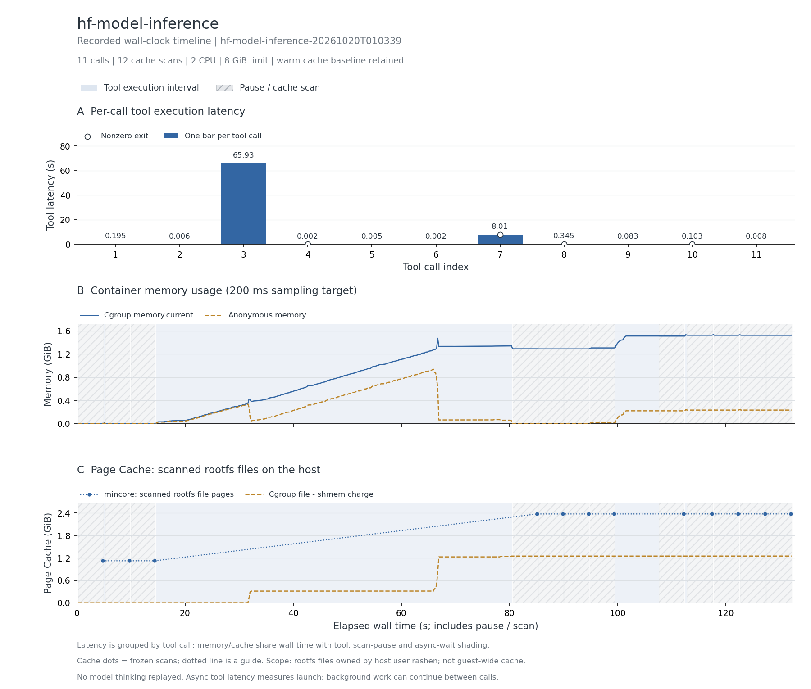

# 模型下载、加载与 HTTP 推理

Terminal-Bench 社区公开轨迹，完整 11 次调用；CPU 运行。

轨迹内服务请求成功；附加正、负样例分类与概率和检查通过。

主记录：`hf-model-inference-20261020T010339`，实验日期 2026-10-20（Asia/Shanghai）。

## 实际执行与输入范围

下载并读取 SST-2 DistilBERT 模型的固定 revision 714eb0fa89d2f80546fda750413ed43d93601a13，/app/model_cache 共 35 个普通文件、逻辑大小约 1,278.6 MiB。执行后台 Flask 服务、一次成功的轨迹内 HTTP 推理，结束后补做正负情感样例检查。snapshot_download 同时下载多个模型格式，目录大小不代表推理使用了全部权重格式。

## 结果表

下表的文件驻留以可扫描根文件系统的 inode/offset 为单位；cgroup 内存包含被计费缓存。它们口径不同，不能相加，也不是实际 read/write 字节量。峰值可能发生于不同时间。

| 指标 | 结果 |
| --- | --- |
| 完整工具调用 / 缓存边界 / 连续样本 | 11 / 12 / 656 |
| CPU 配额 / 内存上限 | 2 CPU / 8 GiB |
| 工具执行合计 / 中位数 / P95 / 最大 (s) | 74.684 / 0.083 / 36.968 / 65.929 |
| 容器调用合计 (s) | 76.057 |
| 测量墙钟 / 暂停总计 / 两遍扫描总计 (s) | 132.237 / 55.942 / 53.149 |
| 后台依赖等待 (s) | 0.000（0 个边界） |
| cgroup 内存内核峰值 / 采样峰值 (MiB) | 1673.980 / 1572.457 |
| 匿名内存峰值 / 文件页计费峰值 (MiB) | 961.492 / 1282.367 |
| 文件驻留：初始 / 最大 / 结束 (MiB) | 1152.023 / 2434.348 / 2434.348 |
| 文件驻留净变化 (MiB) | +1282.324 |
| 扫描中位数 / 采样最大间隔 (s) | 4.429 / 0.282 |
| 非拥有者文件排除数 / 逻辑大小 (MiB) | 0 / 0.000 |
| memory.events max / oom / oom_kill | 0 / 0 / 0 |
| 结束时 Podman SizeRw / SizeRootFs (GiB) | 未采集；不估算磁盘峰值 |
| 非零退出的工具编号 | 4、7、8、10 |
| 与源数值退出码不同的工具编号 | 无 |

## 三项曲线

[矢量图](runs/hf-model-inference-20261020T010339/curves.svg)。第一幅按调用序号画工具时延柱状图，每根柱子表示该次调用的总耗时，空心点表示非零退出。后两幅共用测量墙钟：蓝色阴影标出工具执行区间，灰色斜线标出暂停扫描，金色点纹标出异步依赖等待（如有）；第二幅为容器 cgroup 内存；第三幅明确显示 Page Cache，其中圆点为暂停后的 mincore 扫描值，点间虚线只辅助阅读。

[去除扫描暂停的辅助图](runs/hf-model-inference-20261020T010339/curves-active.png) · [辅助图 SVG](runs/hf-model-inference-20261020T010339/curves-active.svg)。辅助图只压缩暂停区间，仍保留调度与异步等待；暂停期间的内存样本用灰点显示。两种视图均保留初始暖缓存，不包含模型思考。指标定义见[测量说明](../../docs/measurement.md#时间轴与未测项)。

## 文件范围与驻留

以下按结束时驻留量取前八个区域；逻辑大小是文件大小之和，驻留量按页取整。目录分区说明见[测量口径](../../docs/measurement.md)。这些数据描述文件驻留，不能证明本轮调用读取了每个文件。

| 区域 | 结束时文件数 | 逻辑大小 (MiB) | 初始驻留 (MiB) | 结束驻留 (MiB) |
| --- | --- | --- | --- | --- |
| `/model_cache` | 35 | 1278.59 | 0.00 | 1278.70 |
| `/usr` | 30109 | 1077.45 | 1144.94 | 1147.32 |
| `/var` | 520 | 4.80 | 6.37 | 6.37 |
| `/root` | 4 | 1.22 | 0.01 | 1.23 |
| `/etc` | 108 | 0.41 | 0.70 | 0.70 |
| `/app` | 3 | 0.00 | 0.00 | 0.01 |
| `/tmp` | 2 | 0.00 | 0.00 | 0.01 |

总驻留峰值边界为工具 `7` 后。该边界的前五个驻留文件：

| 文件 | 驻留 (MiB) |
| --- | --- |
| `/usr/local/lib/python3.13/site-packages/torch/lib/libtorch_cpu.so` | 398.75 |
| `/app/model_cache/sentiment_model/onnx/model.onnx` | 255.54 |
| `/app/model_cache/sentiment_model/tf_model.h5` | 255.54 |
| `/app/model_cache/sentiment_model/rust_model.ot` | 255.44 |
| `/app/model_cache/sentiment_model/pytorch_model.bin` | 255.44 |

## 时延较长的工具

| 工具编号 | 类型 | 命令摘要 | 时延 (s) | 退出码 |
| --- | --- | --- | --- | --- |
| 3 | bash | python3 /app/download_model.py && ls -la /app/model_cache/sentiment_model | 65.929 | 0 |
| 7 | bash | sleep 8 && cat /app/service.log && echo "---TEST POSITIVE---" && curl -s -X POST http://localhost:5000/sentime | 8.007 | 127 |
| 8 | bash | python3 - <<'EOF' ↵ import json, urllib.request ↵  ↵ def post(payload, raw=False): ↵     data = payload if isi | 0.345 | 1 |
| 1 | bash | ls -la /app && python3 --version && pip list 2>/dev/null \| grep -i -E "torch\|transformers\|flask\|pip" \|\| true | 0.195 | 0 |
| 10 | bash | python3 - <<'EOF' ↵ import json, urllib.request ↵ req = urllib.request.Request("http://127.0.0.1:5000/sentimen | 0.103 | 1 |
| 9 | bash | python3 - <<'EOF' ↵ import json, urllib.request ↵  ↵ req = urllib.request.Request("http://127.0.0.1:5000/senti | 0.083 | 0 |
| 11 | bash | pid="$(cat /probe/work/service.pid)"; ls -d /proc/$pid && cat /proc/$pid/cmdline \| tr '\0' ' ' && echo && tail | 0.008 | 0 |
| 2 | write | mkdir -p /app && cat /probe/input/002.payload > /app/download_model.py | 0.006 | 0 |

## 适配、权限与解释限制

保留无效 write、缺少 curl/ps、错误请求等原始行为；IP 映射到容器 loopback，记录的 PID 映射指向后台 launcher，实际 Python 服务由 cgroup 与 HTTP 检查覆盖。

两遍扫描无错误，changed_pages=0；全部边界确认 frozen=1。指标口径见[测量说明](../../docs/measurement.md)。

优先保留。只读模型权重与 Python/torch 依赖适合研究跨 sandbox 复用；需区分下载缓存、各权重格式与实际加载格式。

本记录的适配类别如下；逐步命令、改动说明和脚本哈希保存在 normalized-steps.json.gz。

- Bash uses default pipeline exit semantics, matching published commands; no implicit pipefail.
- Pin the public model revision; network download time remains part of this tool.
- Native write tool is bridged to a real in-container file write; original content is preserved except explicitly declared adaptations.
- Preserve invalid source write as a validation failure; no destination is inferred.
- Record background service PID for later identity checks.
- Map published container IP to loopback for the same in-container HTTP check.
- Map published PID to the recorded background launcher PID; the Python service can run as its child.

## 数据、来源与复现

- [逐工具时延 CSV](runs/hf-model-inference-20261020T010339/steps.csv)、[边界指标 CSV](runs/hf-model-inference-20261020T010339/boundaries.csv)、[汇总](runs/hf-model-inference-20261020T010339/metrics.json)、[运行配置](runs/hf-model-inference-20261020T010339/run.json)。
- [来源 URL / revision / SHA-256](../../experiments/container-screening/workloads/hf-model-inference/provenance.json)。
- 完整连续序列、逐步命令和 stdout/stderr 保存在 cpu-15 的原始归档。
- [数据说明](../../docs/data-and-sources.md)、[部署说明](../../docs/deployment/README.md)。

[返回十任务总览](../../README.md)
