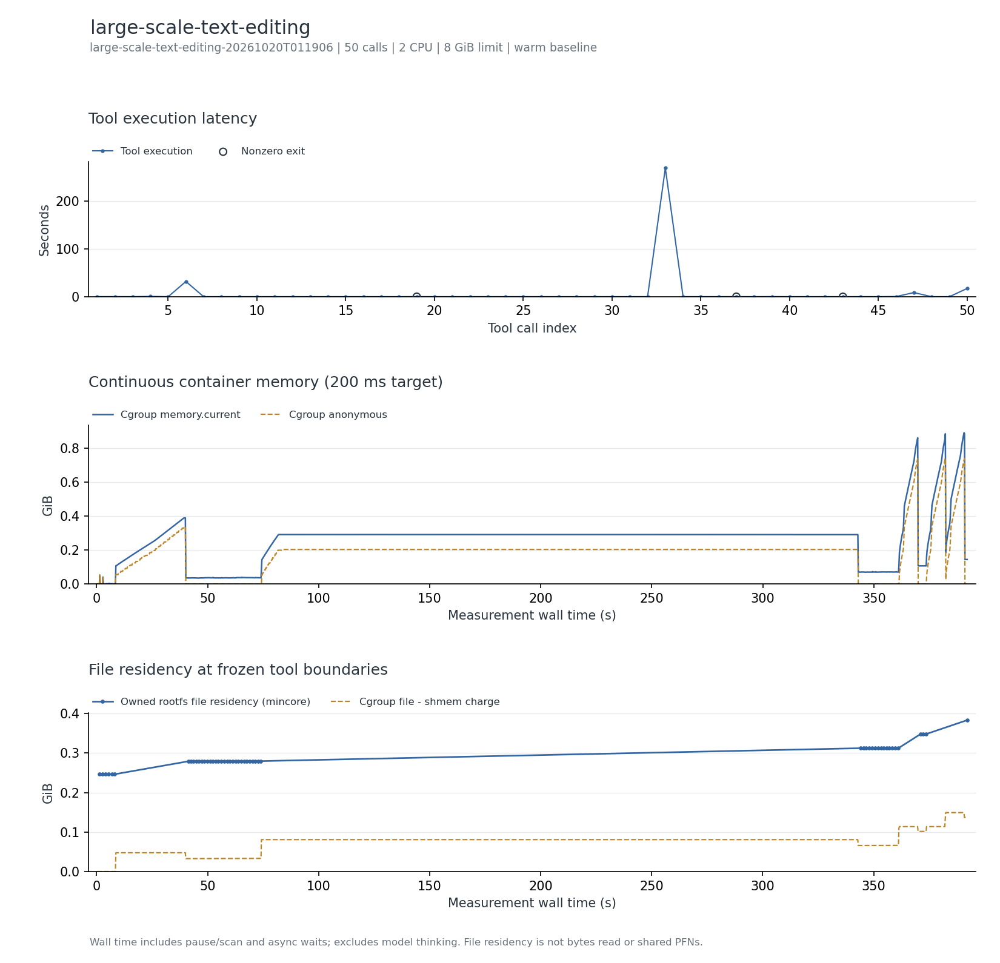

# 百万行 CSV 文本编辑

Terminal-Bench 社区公开轨迹，完整 50 次调用，保留原始失败尝试。

**本轮已完成全部公开调用和三类数据采集。** 本轮最终 output.csv 与 expected.csv 的 cmp 返回 0。源轨迹 published_pass=False；本轮没有运行完整官方判题器。

主记录：`large-scale-text-editing-20261020T011906`，实验日期 2026-10-20（Asia/Shanghai）。本地检查、轨迹重放完成与官方 benchmark 判题是不同结论。

## 实际执行与输入范围

实际读取 /app/input.csv 并生成 /app/output.csv；输入与期望输出各 1,000,000 行，合计约 85.0 MiB。调用包含 shell 文本变换和临时 CSV，最终与 /app/expected.csv 逐字节比较。

## 结果表

下表的文件驻留以可扫描根文件系统的 inode/offset 为单位；cgroup 内存包含被计费缓存。它们口径不同，不能相加，也不是实际 read/write 字节量。峰值可能发生于不同时间。

| 指标 | 结果 |
| --- | --- |
| 完整工具调用 / 缓存边界 / 连续样本 | 50 / 51 / 1,953 |
| CPU 配额 / 内存上限 | 2 CPU / 8 GiB |
| 工具执行合计 / 中位数 / P95 / 最大 (s) | 329.177 / 0.026 / 13.382 / 268.824 |
| 容器调用合计 (s) | 335.746 |
| 测量墙钟 / 暂停总计 / 两遍扫描总计 (s) | 392.189 / 56.160 / 48.362 |
| 后台依赖等待 (s) | 0.000（0 个边界） |
| cgroup 内存内核峰值 / 采样峰值 (MiB) | 920.848 / 912.691 |
| 匿名内存峰值 / 文件页计费峰值 (MiB) | 757.656 / 152.812 |
| 文件驻留：初始 / 最大 / 结束 (MiB) | 252.418 / 392.633 / 392.633 |
| 文件驻留净变化 (MiB) | +140.215 |
| 扫描中位数 / 采样最大间隔 (s) | 0.950 / 0.212 |
| 非拥有者文件排除数 / 逻辑大小 (MiB) | 0 / 0.000 |
| memory.events max / oom / oom_kill | 0 / 0 / 0 |
| 结束时 Podman SizeRw / SizeRootFs (GiB) | 未采集；不估算磁盘峰值 |
| 非零退出的工具编号 | 19、37、43 |
| 与源数值退出码不同的工具编号 | 无 |

## 三项曲线

[矢量图](runs/large-scale-text-editing-20261020T011906/curves.svg)。第一幅按工具编号显示时延，空心标记为非零退出；后两幅横轴含人为暂停扫描和后台等待，不含模型思考。初始暖驻留按实测保留。内核 memory.peak 可能高于 200 ms 序列捕获的峰值，也可能包含预检。

## 文件范围与驻留

以下按结束时驻留量取前八个区域；逻辑大小是文件大小之和，驻留量按页取整。目录分区说明见[测量口径](../../docs/measurement.md)。这些数据描述文件驻留，不能证明本轮调用读取了每个文件。

| 区域 | 结束时文件数 | 逻辑大小 (MiB) | 初始驻留 (MiB) | 结束驻留 (MiB) |
| --- | --- | --- | --- | --- |
| `/usr` | 6317 | 145.12 | 159.93 | 159.93 |
| `/tmp` | 180 | 103.20 | 0.00 | 103.89 |
| `/input_dataset` | 2 | 85.00 | 85.01 | 85.01 |
| `/app` | 3 | 36.30 | 0.00 | 36.31 |
| `/var` | 553 | 5.08 | 6.77 | 6.77 |
| `/etc` | 109 | 0.41 | 0.71 | 0.71 |
| `/root` | 4 | 0.01 | 0.01 | 0.03 |

总驻留峰值边界为工具 `50` 后。该边界的前五个驻留文件：

| 文件 | 驻留 (MiB) |
| --- | --- |
| `/app/input.csv` | 48.70 |
| `/tmp/s_test.csv` | 36.30 |
| `/app/output.csv` | 36.30 |
| `/app/expected.csv` | 36.30 |
| `/tmp/z2.csv` | 33.45 |

## 时延较长的工具

| 工具编号 | 类型 | 命令摘要 | 时延 (s) | 退出码 |
| --- | --- | --- | --- | --- |
| 33 | bash | cd /app && sed -n '1,5p' input.csv > /tmp/z1.csv && printf 'call setreg(%s, ":s/ //g\\<CR>:s/,/;/g\\<CR>")\n'  | 268.824 | 0 |
| 6 | bash | cd /app && md5sum input.csv expected.csv > /tmp/before.md5 && cp input.csv /tmp/test_input.csv && time vim -Nu | 31.857 | 0 |
| 50 | bash | cd /app && rm -f output.csv && time ./solve.sh && diff output.csv expected.csv && echo "=== SOLVE.SH OUTPUT MA | 17.276 | 0 |
| 47 | bash | cd /app && cp input.csv output.csv && time vim -Nu NONE -n -Es /app/output.csv -c ':%s/ //g' -c ':%s/,/;/g' -c | 8.623 | 0 |
| 4 | bash | cd /app && head -2 input.csv && echo === && head -2 expected.csv && echo === && grep -c '[^A-Za-z0-9,; ]' inpu | 0.578 | 0 |
| 46 | bash | cd /app && awk -F',' 'NF!=3{print NR": "$0; c++} END{print "BADLINES="c+0}' input.csv \| head -5 && awk -F';' ' | 0.387 | 0 |
| 39 | bash | cd /app && sed -n '1,3p' input.csv > /tmp/h.csv && vim -Nu NONE -n -Es /tmp/h.csv -c 's/ //g' -c 's/,/;/g' -c  | 0.172 | 0 |
| 19 | bash | cd /app && sed -n '1,10p;99,101p;999,1001p;9999p;99999p;999999p;1000000p' input.csv > /tmp/samp_exp_src.csv && | 0.151 | 1 |

## 适配、权限与解释限制

保留 read 的全文件读取与行区间输出适配；这会产生真实文件读取，但时延不是源工具的语义摘要耗时。

两遍扫描均无错误且 changed_pages=0；每个边界均记录 frozen_verified=true。非零工具退出可对应源轨迹故意保留的失败尝试，不自动说明采集失败。匿名内存、文件驻留与 cgroup 文件计费没有共同的独占物理页分母；尚未测跨租户 PFN 共享或 DAX 效果。

适合作为较小输入、反复文本读写的对照。初筛观察到的缓存增量有限，优先级低于 C4、模型缓存和 CompCert。

本记录的适配类别如下；逐步命令、改动说明和脚本哈希保存在 normalized-steps.json.gz。

- Bash uses default pipeline exit semantics, matching published commands; no implicit pipefail.
- Read adapter resolves the source tool's real path, reads full file bytes, and emits the published line span when available. Original semantic read implementation/timing is unavailable; output formatting is approximate.
- Native write tool is bridged to a real in-container file write; original content is preserved except explicitly declared adaptations.
- Preserve the source write tool's madeExecutable metadata with chmod +x.

## 数据、来源与复现

- [逐工具时延 CSV](runs/large-scale-text-editing-20261020T011906/steps.csv)、[边界指标 CSV](runs/large-scale-text-editing-20261020T011906/boundaries.csv)、[汇总](runs/large-scale-text-editing-20261020T011906/metrics.json)、[运行配置](runs/large-scale-text-editing-20261020T011906/run.json)。
- [来源 URL / revision / SHA-256](../../experiments/container-screening/workloads/large-scale-text-editing/provenance.json)。
- 完整连续序列、逐步命令和 stdout/stderr 保留于 cpu-15 的原始归档，本次不公开上传压缩包；它们不影响直接阅读本页图表和结果。
- [数据说明](../../docs/data-and-sources.md)、[部署说明](../../docs/deployment/README.md)。

[返回十任务总览](../../README.md)
