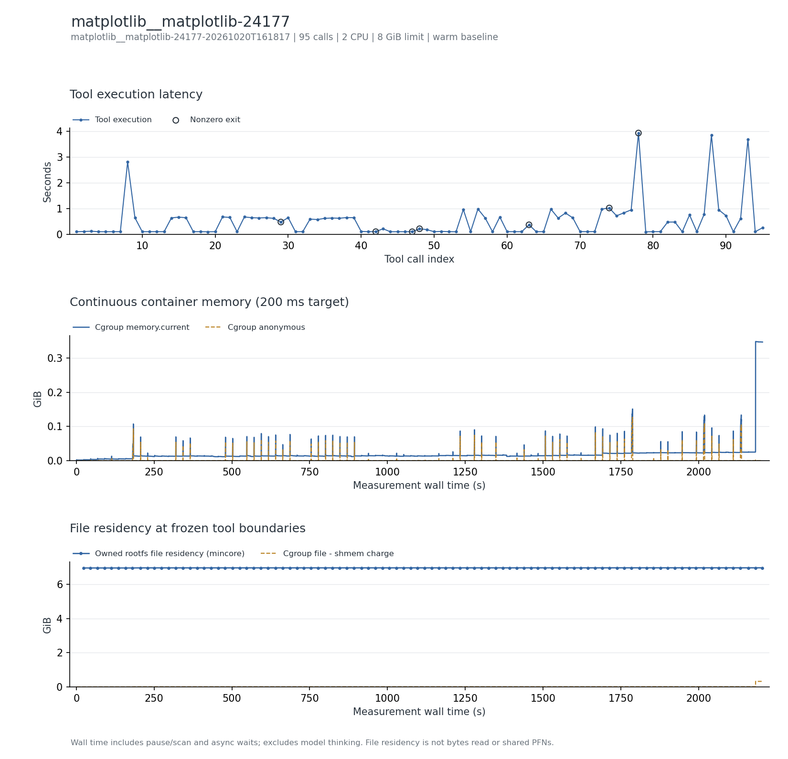

# Matplotlib 源码修复与局部测试

Devstral2 公开轨迹：94 次带 returncode 的执行加最终提交命令，共 95 次；94 次模型格式错误不算工具调用。

**本轮已完成全部公开调用和三类数据采集。** 第 93 步局部测试 60 passed、10 skipped、762 deselected；最终补丁与公开提交一致（忽略 index 缩写），导入检查通过。

主记录：`matplotlib__matplotlib-24177-20261020T161817`，实验日期 2026-10-20（Asia/Shanghai）。本地检查、轨迹重放完成与官方 benchmark 判题是不同结论。

## 实际执行与输入范围

在固定 SWE-bench 镜像中浏览与修改 lib/matplotlib/axes/_axes.py，执行直方图相关局部测试，最终 diff 与公开提交比对。根文件系统大部分是已预热的 Conda 包缓存和系统依赖；本轮新增驻留仅约 8.9 MiB。

## 结果表

下表的文件驻留以可扫描根文件系统的 inode/offset 为单位；cgroup 内存包含被计费缓存。它们口径不同，不能相加，也不是实际 read/write 字节量。峰值可能发生于不同时间。

| 指标 | 结果 |
| --- | --- |
| 完整工具调用 / 缓存边界 / 连续样本 | 95 / 96 / 10,868 |
| CPU 配额 / 内存上限 | 2 CPU / 8 GiB |
| 工具执行合计 / 中位数 / P95 / 最大 (s) | 48.576 / 0.217 / 0.996 / 3.931 |
| 容器调用合计 (s) | 58.234 |
| 测量墙钟 / 暂停总计 / 两遍扫描总计 (s) | 2205.877 / 2147.101 / 2096.874 |
| 后台依赖等待 (s) | 0.000（0 个边界） |
| cgroup 内存内核峰值 / 采样峰值 (MiB) | 360.184 / 356.355 |
| 匿名内存峰值 / 文件页计费峰值 (MiB) | 129.945 / 332.312 |
| 文件驻留：初始 / 最大 / 结束 (MiB) | 7129.500 / 7138.395 / 7138.395 |
| 文件驻留净变化 (MiB) | +8.895 |
| 扫描中位数 / 采样最大间隔 (s) | 21.846 / 0.343 |
| 非拥有者文件排除数 / 逻辑大小 (MiB) | 757 / 12.441 |
| memory.events max / oom / oom_kill | 0 / 0 / 0 |
| 结束时 Podman SizeRw / SizeRootFs (GiB) | 0.323 / 7.128（均非磁盘峰值） |
| 非零退出的工具编号 | 29、42、47、48、63、74、78 |
| 与源数值退出码不同的工具编号 | 无 |

## 三项曲线

[矢量图](runs/matplotlib__matplotlib-24177-20261020T161817/curves.svg)。第一幅按工具编号显示时延，空心标记为非零退出；后两幅横轴含人为暂停扫描和后台等待，不含模型思考。初始暖驻留按实测保留。内核 memory.peak 可能高于 200 ms 序列捕获的峰值，也可能包含预检。

## 文件范围与驻留

以下按结束时驻留量取前八个区域；逻辑大小是文件大小之和，驻留量按页取整。目录分区说明见[测量口径](../../docs/measurement.md)。这些数据描述文件驻留，不能证明本轮调用读取了每个文件。

| 区域 | 结束时文件数 | 逻辑大小 (MiB) | 初始驻留 (MiB) | 结束驻留 (MiB) |
| --- | --- | --- | --- | --- |
| `/opt` | 79348 | 4202.90 | 4392.98 | 4393.62 |
| `/usr` | 57675 | 1827.28 | 1970.78 | 1970.78 |
| `/git_metadata` | 33 | 333.01 | 333.01 | 333.11 |
| `/var` | 2937 | 136.77 | 146.21 | 146.21 |
| `/miniconda.sh` | 1 | 135.05 | 135.05 | 135.05 |
| `/testbed` | 4971 | 86.58 | 90.23 | 97.28 |
| `/root` | 169 | 59.35 | 59.52 | 59.76 |
| `/etc` | 282 | 0.90 | 1.71 | 1.71 |

总驻留峰值边界为工具 `95` 后。该边界的前五个驻留文件：

| 文件 | 驻留 (MiB) |
| --- | --- |
| `/opt/miniconda3/pkgs/cache/497deca9.json` | 415.51 |
| `/testbed/.git/objects/pack/pack-d4da5486fbe98ccc0301d0a59f9f7e668ab3964f.pack` | 322.04 |
| `/opt/miniconda3/pkgs/cache/09cdf8bf.json` | 173.86 |
| `/opt/miniconda3/pkgs/libllvm19-19.1.7-ha7bfdaf_1/lib/libLLVM.so.19.1` | 158.62 |
| `/opt/miniconda3/pkgs/pandoc-3.6.3-ha770c72_0/bin/pandoc` | 145.49 |

## 时延较长的工具

| 工具编号 | 类型 | 命令摘要 | 时延 (s) | 退出码 |
| --- | --- | --- | --- | --- |
| 78 | bash | exec bash -lc 'cd /testbed && python -m pytest lib/matplotlib/tests/test_axes.py -k hist -x ↵ ' | 3.931 | 1 |
| 88 | bash | exec bash -lc 'cd /testbed && python -m pytest lib/matplotlib/tests/test_axes.py -k hist -x ↵ ' | 3.847 | 0 |
| 93 | bash | exec bash -lc 'cd /testbed && python -m pytest lib/matplotlib/tests/test_axes.py -k hist -x -q ↵ ' | 3.692 | 0 |
| 8 | bash | exec bash -lc 'cat <<'"'"'EOF'"'"' > /tmp/test_hist_bug.py ↵ import numpy as np ↵ import matplotlib.pyplot as  | 2.812 | 0 |
| 74 | bash | exec bash -lc 'cd /testbed && python -m pytest lib/matplotlib/tests/test_axes.py::TestAxes::test_hist -xvs ↵ ' | 1.022 | 4 |
| 56 | bash | exec bash -lc 'python /tmp/test_hist_scale.py ↵ ' | 0.984 | 0 |
| 73 | bash | exec bash -lc 'python /tmp/test_hist_scale.py ↵ ' | 0.982 | 0 |
| 66 | bash | exec bash -lc 'python /tmp/test_hist_scale.py ↵ ' | 0.978 | 0 |

## 适配、权限与解释限制

专用 Podman 存储导入镜像时启用 ignore_chown_errors 兼容无法映射的 UID/GID，权限语义有所变化。扫描排除 757 个非拥有者文件、12.44 MiB；不用于评估权限隔离。

两遍扫描均无错误且 changed_pages=0；每个边界均记录 frozen_verified=true。非零工具退出可对应源轨迹故意保留的失败尝试，不自动说明采集失败。匿名内存、文件驻留与 cgroup 文件计费没有共同的独占物理页分母；尚未测跨租户 PFN 共享或 DAX 效果。

保留为源码检索/小补丁/局部测试对照，优先级低于实测活跃文件较多的候选。约 7 GiB 暖驻留不能解释为本轮读取了约 7 GiB。

本记录的适配类别如下；逐步命令、改动说明和脚本哈希保存在 normalized-steps.json.gz。

- Bash uses default pipeline exit semantics, matching published commands; no implicit pipefail.
- Match mini-swe-agent DockerEnvironment's login Bash invocation, activating the image's Conda testbed environment.

## 数据、来源与复现

- [逐工具时延 CSV](runs/matplotlib__matplotlib-24177-20261020T161817/steps.csv)、[边界指标 CSV](runs/matplotlib__matplotlib-24177-20261020T161817/boundaries.csv)、[汇总](runs/matplotlib__matplotlib-24177-20261020T161817/metrics.json)、[运行配置](runs/matplotlib__matplotlib-24177-20261020T161817/run.json)。
- [来源 URL / revision / SHA-256](../../experiments/container-screening/workloads/matplotlib__matplotlib-24177/provenance.json)。
- 完整连续序列、逐步命令和 stdout/stderr 保留于 cpu-15 的原始归档，本次不公开上传压缩包；它们不影响直接阅读本页图表和结果。
- [数据说明](../../docs/data-and-sources.md)、[部署说明](../../docs/deployment/README.md)。

[返回十任务总览](../../README.md)
