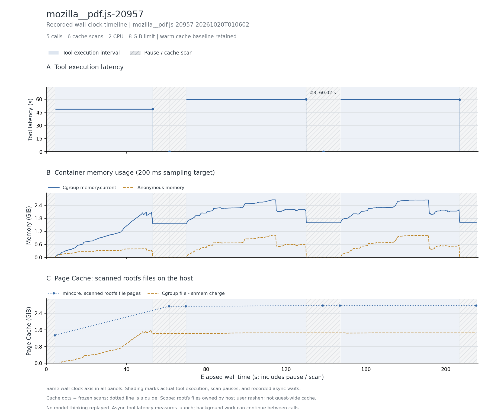

# PDF.js 依赖安装与 CLI 测试

RepoLaunch setup.log 中 5 条安装、构建、CLI 测试命令；不包含完整 issue 修复轨迹。

两轮 CLI 测试均为 1,127 specs、0 failures、56 pending；结束后检查 node_modules 与 build 目录。

主记录：`mozilla__pdf.js-20957-20261020T010602`，实验日期 2026-10-20（Asia/Shanghai）。

## 实际执行与输入范围

在 base commit 484518614d75c1ac1f1a8db41c943774b5231de6 执行 npm ci、构建和两轮 CLI 测试；安装 905 个 npm 包。node_modules 扫描到 27,974 个文件、逻辑大小约 230.7 MiB；安装阶段还产生 Puppeteer 浏览器缓存。

## 结果表

下表的文件驻留以可扫描根文件系统的 inode/offset 为单位；cgroup 内存包含被计费缓存。它们口径不同，不能相加，也不是实际 read/write 字节量。峰值可能发生于不同时间。

| 指标 | 结果 |
| --- | --- |
| 完整工具调用 / 缓存边界 / 连续样本 | 5 / 6 / 1,070 |
| CPU 配额 / 内存上限 | 2 CPU / 8 GiB |
| 工具执行合计 / 中位数 / P95 / 最大 (s) | 168.358 / 48.749 / 59.932 / 60.020 |
| 容器调用合计 (s) | 169.056 |
| 测量墙钟 / 暂停总计 / 两遍扫描总计 (s) | 215.337 / 46.066 / 44.263 |
| 后台依赖等待 (s) | 0.000（0 个边界） |
| cgroup 内存内核峰值 / 采样峰值 (MiB) | 2721.117 / 2715.117 |
| 匿名内存峰值 / 文件页计费峰值 (MiB) | 1047.191 / 1627.277 |
| 文件驻留：初始 / 最大 / 结束 (MiB) | 1376.652 / 2835.445 / 2835.445 |
| 文件驻留净变化 (MiB) | +1458.793 |
| 扫描中位数 / 采样最大间隔 (s) | 8.037 / 0.277 |
| 非拥有者文件排除数 / 逻辑大小 (MiB) | 14 / 5.097 |
| memory.events max / oom / oom_kill | 0 / 0 / 0 |
| 结束时 Podman SizeRw / SizeRootFs (GiB) | 未采集；不估算磁盘峰值 |
| 非零退出的工具编号 | 无 |
| 与源数值退出码不同的工具编号 | 无 |

## 三项曲线

[矢量图](runs/mozilla__pdf.js-20957-20261020T010602/curves.svg)。三幅图共用测量墙钟：蓝色阴影标出工具执行区间，灰色斜线标出暂停扫描，金色点纹标出异步依赖等待（如有）。第一幅显示逐工具时延，空心点表示非零退出；第二幅为容器 cgroup 内存；第三幅明确显示 Page Cache，其中圆点为暂停后的 mincore 扫描值，点间虚线只辅助阅读。

[去除扫描暂停的辅助图](runs/mozilla__pdf.js-20957-20261020T010602/curves-active.png) · [辅助图 SVG](runs/mozilla__pdf.js-20957-20261020T010602/curves-active.svg)。辅助图只压缩暂停区间，仍保留调度与异步等待；暂停期间的内存样本用灰点显示。两种视图均保留初始暖缓存，不包含模型思考。指标定义见[测量说明](../../docs/measurement.md#时间轴与未测项)。

## 文件范围与驻留

以下按结束时驻留量取前八个区域；逻辑大小是文件大小之和，驻留量按页取整。目录分区说明见[测量口径](../../docs/measurement.md)。这些数据描述文件驻留，不能证明本轮调用读取了每个文件。

| 区域 | 结束时文件数 | 逻辑大小 (MiB) | 初始驻留 (MiB) | 结束驻留 (MiB) |
| --- | --- | --- | --- | --- |
| `/usr` | 25237 | 1059.08 | 1115.40 | 1115.40 |
| `/root` | 3197 | 1101.83 | 0.01 | 1110.48 |
| `/dependencies` | 27974 | 230.71 | 0.00 | 308.52 |
| `/testbed` | 3572 | 179.73 | 151.35 | 188.58 |
| `/git_metadata` | 23 | 94.01 | 94.08 | 94.08 |
| `/var` | 1739 | 9.07 | 14.48 | 14.48 |
| `/tmp` | 564 | 1.28 | 0.00 | 2.57 |
| `/etc` | 184 | 0.82 | 1.34 | 1.34 |

总驻留峰值边界为工具 `5` 后。该边界的前五个驻留文件：

| 文件 | 驻留 (MiB) |
| --- | --- |
| `/root/.cache/puppeteer/chrome/linux-146.0.7680.76/chrome-linux64/chrome` | 259.35 |
| `/root/.cache/puppeteer/firefox/linux-nightly_160.0a1/firefox/libxul.so` | 235.73 |
| `/root/.cache/puppeteer/chrome-headless-shell/linux-146.0.7680.76/chrome-headless-shell-linux64/chrome-headless-shell` | 176.28 |
| `/usr/local/bin/node` | 119.05 |
| `/testbed/.git/objects/pack/pack-e6f6e4dfe08547501c649550beefa5360f7a633d.pack` | 93.69 |

## 时延较长的工具

| 工具编号 | 类型 | 命令摘要 | 时延 (s) | 退出码 |
| --- | --- | --- | --- | --- |
| 3 | bash | npx gulp unittestcli | 60.020 | 0 |
| 5 | bash | npx gulp unittestcli | 59.581 | 0 |
| 1 | bash | npm ci | 48.749 | 0 |
| 2 | bash | cat package.json | 0.004 | 0 |
| 4 | bash | sed -n '1,200p' test/reporter.js | 0.004 | 0 |

## 适配、权限与解释限制

只覆盖公开的环境准备与测试命令。排除 14 个非拥有者文件、约 5.1 MiB，其真实驻留量未知。源码与 setup.log 从 main 获取，以下载内容哈希留存；原记录未固定 archive 仓库提交。

两遍扫描无错误，changed_pages=0；全部边界确认 frozen=1。指标口径见[测量说明](../../docs/measurement.md)。

优先保留为短轨迹依赖安装工作负载。npm 依赖、浏览器和基础系统页具有复用机会；不能据此评价修复 Agent 的行为。

本记录的适配类别如下；逐步命令、改动说明和脚本哈希保存在 normalized-steps.json.gz。

- Bash uses default pipeline exit semantics, matching published commands; no implicit pipefail.

## 数据、来源与复现

- [逐工具时延 CSV](runs/mozilla__pdf.js-20957-20261020T010602/steps.csv)、[边界指标 CSV](runs/mozilla__pdf.js-20957-20261020T010602/boundaries.csv)、[汇总](runs/mozilla__pdf.js-20957-20261020T010602/metrics.json)、[运行配置](runs/mozilla__pdf.js-20957-20261020T010602/run.json)。
- [来源 URL / revision / SHA-256](../../experiments/container-screening/workloads/mozilla__pdf.js-20957/provenance.json)。
- 完整连续序列、逐步命令和 stdout/stderr 保存在 cpu-15 的原始归档。
- [数据说明](../../docs/data-and-sources.md)、[部署说明](../../docs/deployment/README.md)。

[返回十任务总览](../../README.md)
