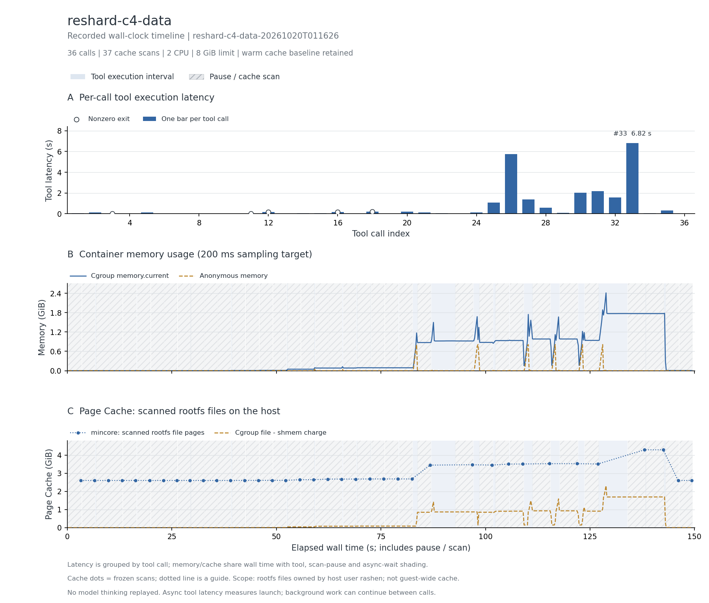

# C4 多文件压缩与解压

Terminal-Bench 社区公开解题轨迹，完整 36 次调用。

轨迹内第 33、34 步的全量往返与目录比对通过；附加检查验证脚本存在且可编译。

主记录：`reshard-c4-data-20261020T011626`，实验日期 2026-10-20（Asia/Shanghai）。

## 实际执行与输入范围

实际输入为 /app/c4_sample：9,898 个文件、779.6 MiB（逻辑大小）；执行全量压缩、解压、逐字节内容与目录结构比较。镜像还带有 Hugging Face C4 Arrow/下载缓存；扫描覆盖这些文件，但不能据此认定本轮调用读取了所有镜像缓存。

## 结果表

下表的文件驻留以可扫描根文件系统的 inode/offset 为单位；cgroup 内存包含被计费缓存。它们口径不同，不能相加，也不是实际 read/write 字节量。峰值可能发生于不同时间。

| 指标 | 结果 |
| --- | --- |
| 完整工具调用 / 缓存边界 / 连续样本 | 36 / 37 / 738 |
| CPU 配额 / 内存上限 | 2 CPU / 8 GiB |
| 工具执行合计 / 中位数 / P95 / 最大 (s) | 23.418 / 0.091 / 3.066 / 6.822 |
| 容器调用合计 (s) | 28.238 |
| 测量墙钟 / 暂停总计 / 两遍扫描总计 (s) | 149.470 / 120.986 / 112.623 |
| 后台依赖等待 (s) | 0.000（0 个边界） |
| cgroup 内存内核峰值 / 采样峰值 (MiB) | 2620.738 / 2469.012 |
| 匿名内存峰值 / 文件页计费峰值 (MiB) | 829.543 / 2365.266 |
| 文件驻留：初始 / 最大 / 结束 (MiB) | 2660.680 / 4390.609 / 2660.785 |
| 文件驻留净变化 (MiB) | +0.105 |
| 扫描中位数 / 采样最大间隔 (s) | 2.903 / 0.288 |
| 非拥有者文件排除数 / 逻辑大小 (MiB) | 0 / 0.000 |
| memory.events max / oom / oom_kill | 0 / 0 / 0 |
| 结束时 Podman SizeRw / SizeRootFs (GiB) | 未采集；不估算磁盘峰值 |
| 非零退出的工具编号 | 3、11、12、16、18 |
| 与源数值退出码不同的工具编号 | 33 |

## 三项曲线

[矢量图](runs/reshard-c4-data-20261020T011626/curves.svg)。第一幅按调用序号画工具时延柱状图，每根柱子表示该次调用的总耗时，空心点表示非零退出。后两幅共用测量墙钟：蓝色阴影标出工具执行区间，灰色斜线标出暂停扫描，金色点纹标出异步依赖等待（如有）；第二幅为容器 cgroup 内存；第三幅明确显示 Page Cache，其中圆点为暂停后的 mincore 扫描值，点间虚线只辅助阅读。

[去除扫描暂停的辅助图](runs/reshard-c4-data-20261020T011626/curves-active.png) · [辅助图 SVG](runs/reshard-c4-data-20261020T011626/curves-active.svg)。辅助图只压缩暂停区间，仍保留调度与异步等待；暂停期间的内存样本用灰点显示。两种视图均保留初始暖缓存，不包含模型思考。指标定义见[测量说明](../../docs/measurement.md#时间轴与未测项)。

## 文件范围与驻留

以下按结束时驻留量取前八个区域；逻辑大小是文件大小之和，驻留量按页取整。目录分区说明见[测量口径](../../docs/measurement.md)。这些数据描述文件驻留，不能证明本轮调用读取了每个文件。

| 区域 | 结束时文件数 | 逻辑大小 (MiB) | 初始驻留 (MiB) | 结束驻留 (MiB) |
| --- | --- | --- | --- | --- |
| `/root` | 6301 | 1671.20 | 1685.93 | 1685.93 |
| `/input_dataset` | 9898 | 779.59 | 798.98 | 798.98 |
| `/usr` | 4573 | 158.20 | 168.70 | 168.70 |
| `/var` | 519 | 4.80 | 6.37 | 6.37 |
| `/etc` | 108 | 0.41 | 0.70 | 0.70 |
| `/app` | 20 | 0.05 | 0.00 | 0.10 |
| `/tmp` | 2 | 0.00 | 0.00 | 0.00 |

总驻留峰值边界为工具 `34` 后。该边界的前五个驻留文件：

| 文件 | 驻留 (MiB) |
| --- | --- |
| `/root/.cache/huggingface/datasets/allenai___c4/default-b04fc8a0b8562884/0.0.0/1588ec454efa1a09f29cd18ddd04fe05fc8653a2/c4-train-00000-of-00002.arrow` | 479.87 |
| `/root/.cache/huggingface/hub/datasets--allenai--c4/blobs/8ef8d75b0e045dec4aa5123a671b4564466b0707086a7ed1ba8721626dfffbc9` | 304.52 |
| `/root/.cache/huggingface/datasets/allenai___c4/default-b04fc8a0b8562884/0.0.0/1588ec454efa1a09f29cd18ddd04fe05fc8653a2/c4-train-00001-of-00002.arrow` | 286.94 |
| `/root/.cache/huggingface/xet/https___cas_serv-tGqkUaZf_CBPHQ6h/chunk-cache/ND/NDKhXTSgKSEoeC4QcDpbvYmf5CMkL41VMytcL_9PWmhkZWZhdWx0/AAAAAGUEAABLx_8DAAAAAPrZ3l4=` | 63.99 |
| `/root/.cache/huggingface/xet/https___cas_serv-tGqkUaZf_CBPHQ6h/chunk-cache/aO/aO3dpkI8fYHPagK3ptNmgPkLFaJLezIM2koEPWyZ8g5kZWZhdWx0/AAAAAGMEAADwef8DAAAAANqA21E=` | 63.97 |

## 时延较长的工具

| 工具编号 | 类型 | 命令摘要 | 时延 (s) | 退出码 |
| --- | --- | --- | --- | --- |
| 33 | bash | rm -rf /tmp/finalout && python /app/compress.py /app/c4_sample /tmp/finalout && python - <<'EOF' ↵ import os ↵ | 6.822 | 0 |
| 26 | bash | time python /app/decompress.py /tmp/c4out && ls /tmp/c4out \| wc -l && echo "=== hash compare ===" && (cd /app/ | 5.742 | 0 |
| 31 | bash | rm -rf /tmp/c4out && python /app/compress.py /app/c4_sample /tmp/c4out >/dev/null && S=$(find /tmp/c4out -name | 2.174 | 0 |
| 30 | bash | rm -rf /tmp/c4out && python /app/compress.py /app/c4_sample /tmp/c4out >/dev/null && S=$(find /tmp/c4out -name | 2.043 | 0 |
| 32 | bash | rm -rf /tmp/c4out && python /app/compress.py /app/c4_sample /tmp/c4out >/dev/null && S=$(find /tmp/c4out -name | 1.562 | 0 |
| 27 | bash | python /app/decompress.py /tmp/c4out && (cd /tmp/c4out && find . -type f \| wc -l) && echo "--- mtime check --- | 1.400 | 0 |
| 25 | bash | rm -rf /tmp/c4out && time python /app/compress.py /app/c4_sample /tmp/c4out && echo "=== constraints check === | 1.081 | 0 |
| 28 | bash | rm -rf /tmp/out1 /tmp/out2 && python /app/compress.py /tmp/t1 /tmp/out1 && python /app/decompress.py /tmp/out1 | 0.585 | 0 |

## 适配、权限与解释限制

第 33 步源记录中的 /dev/fd cmp Illegal seek 未复现，本轮命令成功；不是逐退出状态相同的重放。

两遍扫描无错误，changed_pages=0；全部边界确认 frozen=1。指标口径见[测量说明](../../docs/measurement.md)。

优先保留。输入可在多个实例之间复用，临时压缩包和解压输出主要是各实例私有页，应分别评估。

本记录的适配类别如下；逐步命令、改动说明和脚本哈希保存在 normalized-steps.json.gz。

- Bash uses default pipeline exit semantics, matching published commands; no implicit pipefail.
- Native write tool is bridged to a real in-container file write; original content is preserved except explicitly declared adaptations.
- Preserve the source write tool's madeExecutable metadata with chmod +x.

## 数据、来源与复现

- [逐工具时延 CSV](runs/reshard-c4-data-20261020T011626/steps.csv)、[边界指标 CSV](runs/reshard-c4-data-20261020T011626/boundaries.csv)、[汇总](runs/reshard-c4-data-20261020T011626/metrics.json)、[运行配置](runs/reshard-c4-data-20261020T011626/run.json)。
- [来源 URL / revision / SHA-256](../../experiments/container-screening/workloads/reshard-c4-data/provenance.json)。
- 完整连续序列、逐步命令和 stdout/stderr 保存在 cpu-15 的原始归档。
- [数据说明](../../docs/data-and-sources.md)、[部署说明](../../docs/deployment/README.md)。

[返回十任务总览](../../README.md)
